# COMP1019 – Buổi 9 – Lab 09
## Thiết kế và in thẻ sinh viên bằng WinForms

### 1. Giới thiệu

Ứng dụng cho phép nhập thông tin sinh viên, chọn ảnh đại diện, xem trước thẻ được vẽ bằng GDI+ và xem trước/in thẻ bằng `PrintDocument`. Dữ liệu được nhập trực tiếp trên Form, không sử dụng cơ sở dữ liệu.

### 2. Chức năng

- Nhập mã sinh viên, họ tên, lớp, khoa, khóa học, ngày sinh và giới tính.
- Chọn ảnh JPG, JPEG, PNG hoặc BMP; ảnh giữ đúng tỷ lệ.
- Tự cập nhật preview thẻ khi thông tin thay đổi.
- Kiểm tra thông tin bắt buộc trước khi xem trước/in.
- Xem trước bản in, chọn máy in hoặc Microsoft Print to PDF.
- Làm mới thông tin và ảnh đại diện.

### 4. Ảnh giao diện

**Form chính**

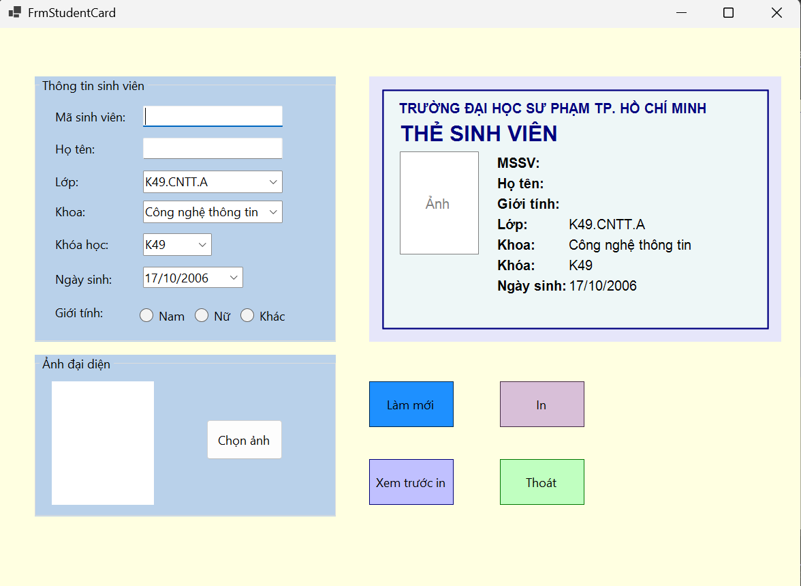

### 5. Kết quả kiểm thử

#### 1. Chạy chương trình

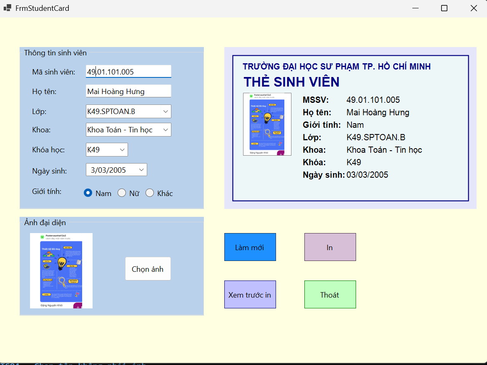

#### 2. Preview tự cập nhật

####  3. Chọn ảnh JPG hợp lệ

- **Kết quả:** Ảnh xuất hiện trong PictureBox và preview, không bị méo. 

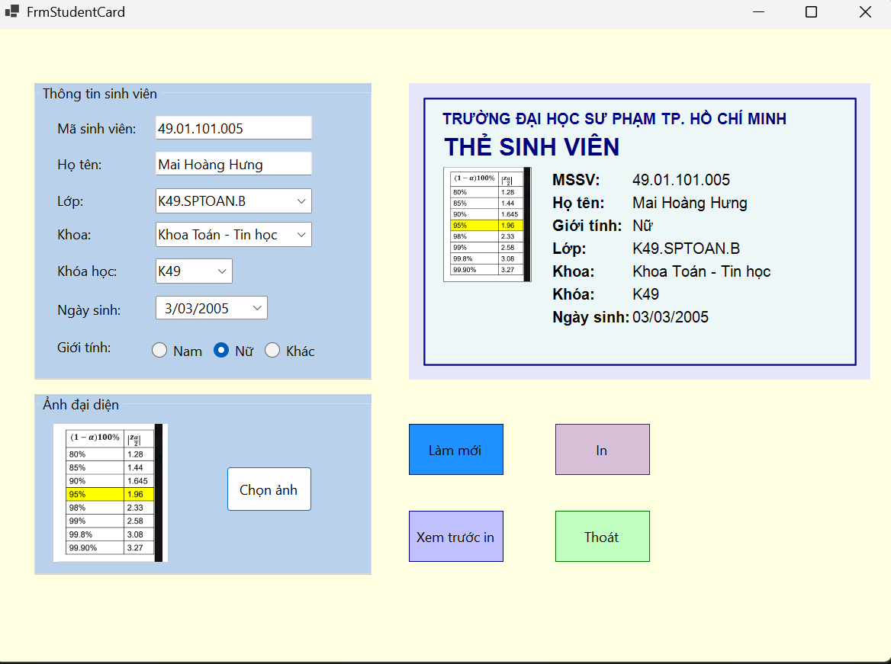

####  4. Chọn tệp không phải ảnh

- **Kết quả:** Chương trình báo ảnh không hợp lệ và không bị thoát đột ngột. 

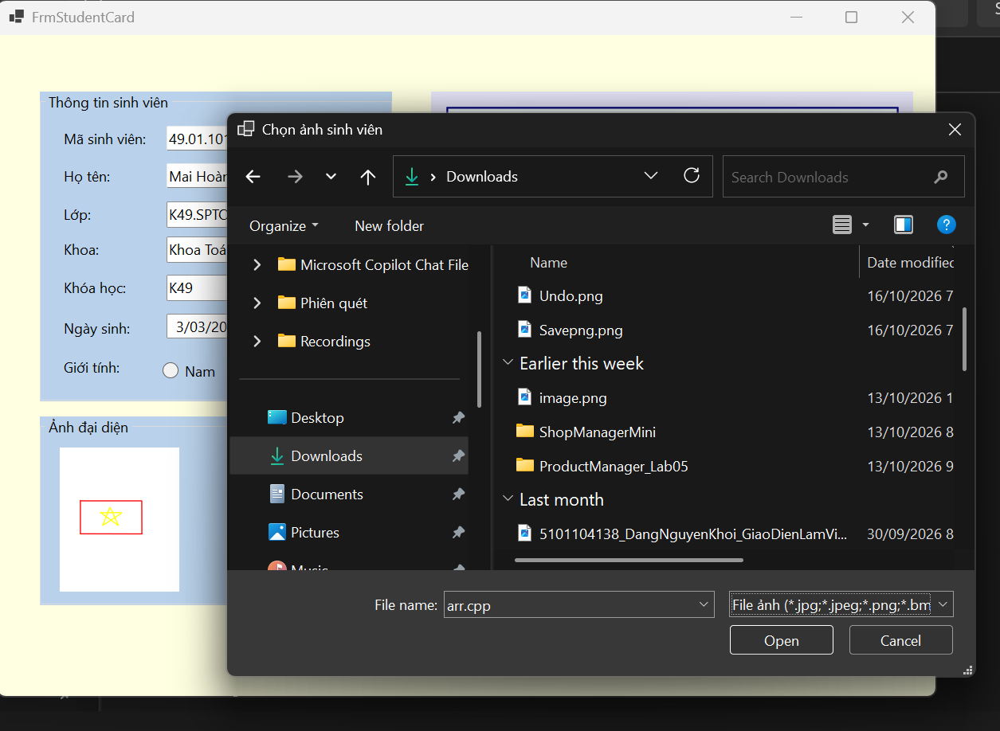
##### Nhập tên file có trên máy là arr.cpp tại mục nhập tên file

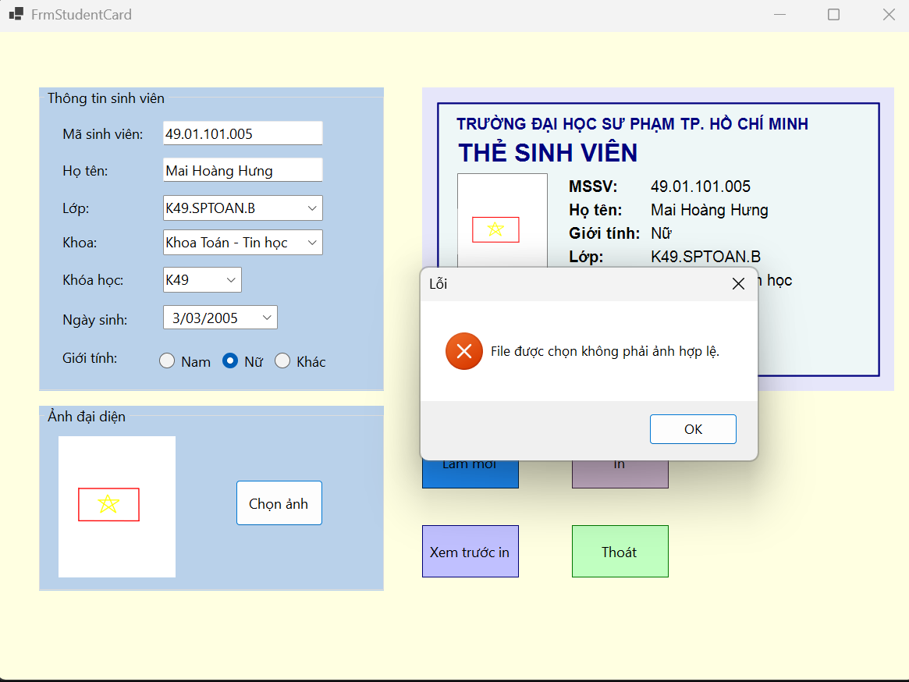
##### Chương trình sẽ báo lỗi khi thứ nhập vào không phải ảnh có định dạng theo yêu cầu

####  5. Đổi ảnh nhiều lần

- **Kết quả:** Ảnh và preview được cập nhật, chương trình không bị treo. Có kèm bấm giờ dể thể hiện thời gian đổi ảnh là gần nhau

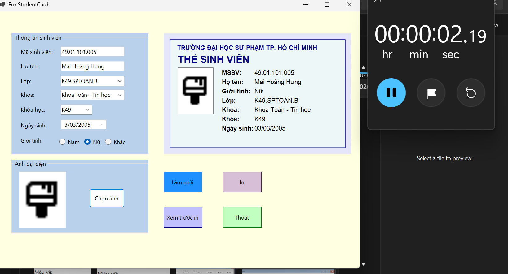
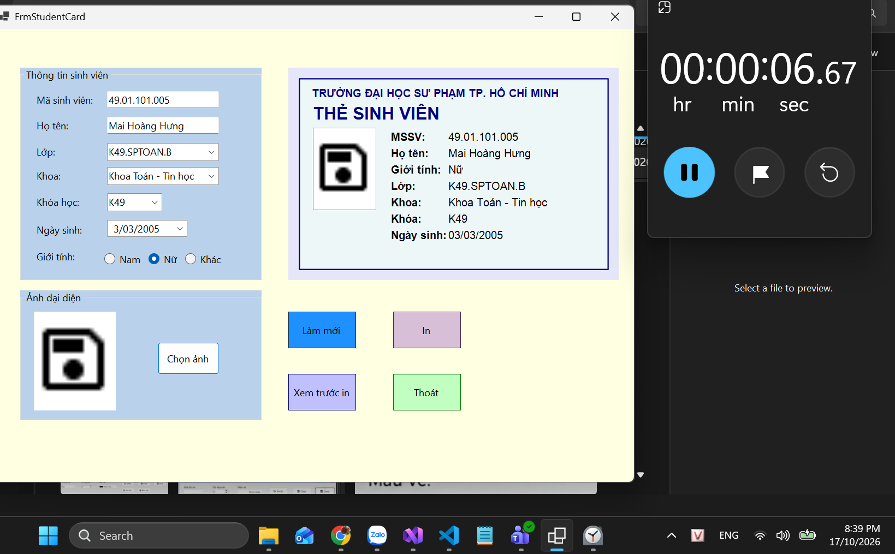
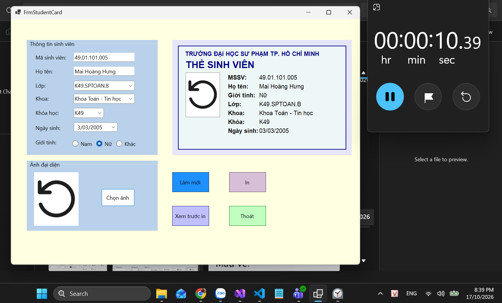

####  6. Xem trước in khi thiếu mã sinh viên và họ tên

- **Kết quả:** Chương trình cảnh báo yêu cầu nhập mã sinh viên, họ tên không mở Print Preview.

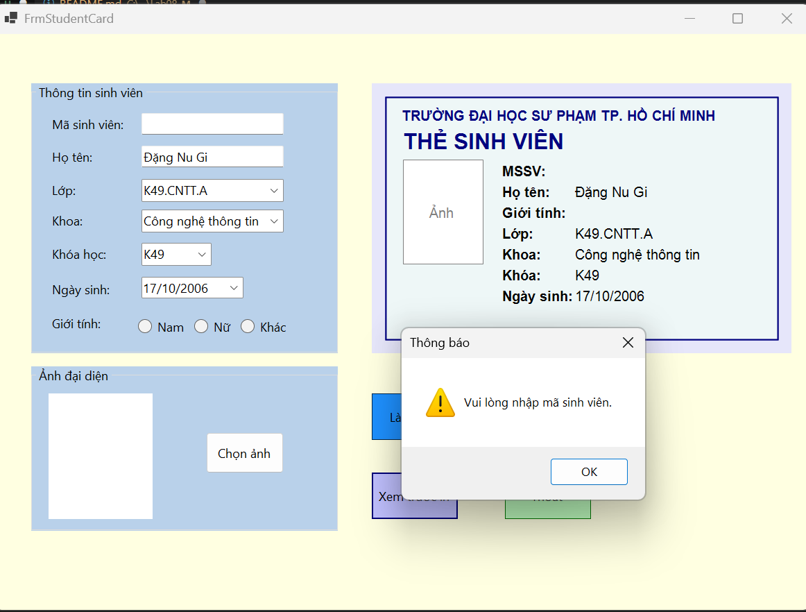
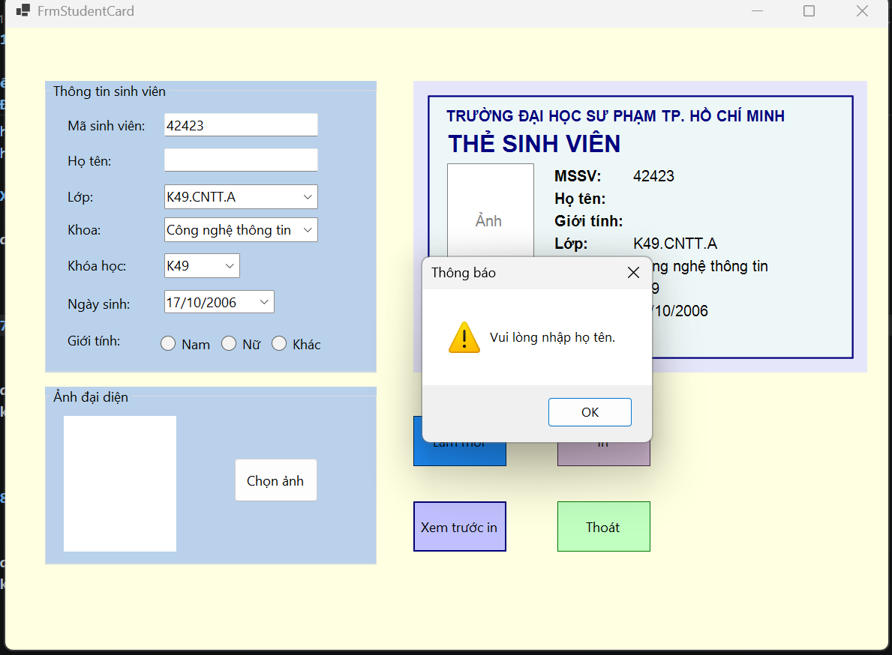

####  7. Xem trước in khi đủ dữ liệu

- **Kết quả:** Print Preview mở ra, thẻ hiển thị tiêu đề, ảnh và thông tin sinh viên. 

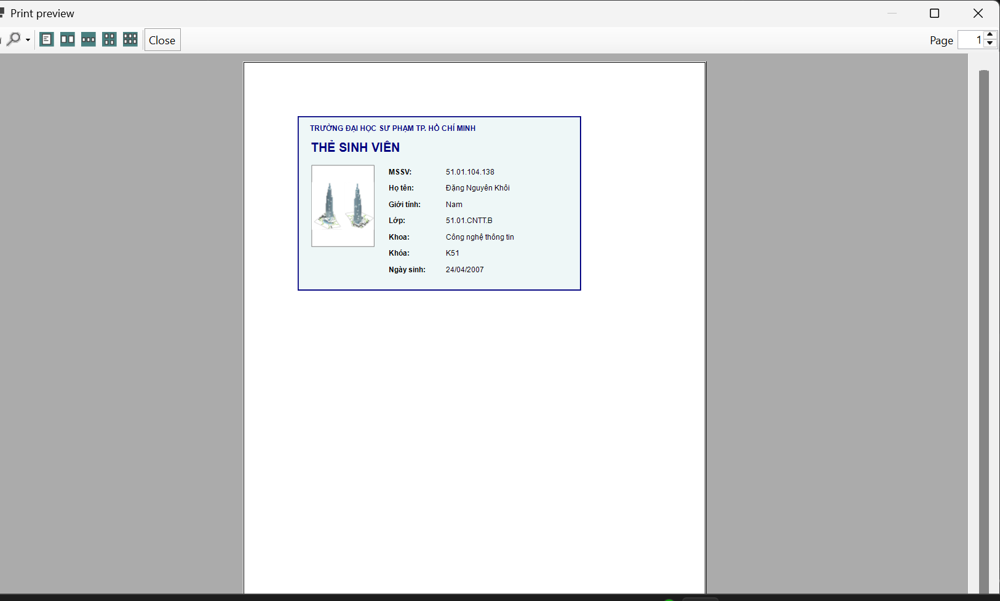

####  8. Ảnh trên bản in không bị méo

- **Kết quả:** Ảnh giữ đúng tỷ lệ, không bị kéo giãn. 

####  9. In bằng Microsoft Print to PDF

- **Bước 1:** Tạo file TheSV_Lab09 để chứa thẻ sinh viên
- **Bước 2:** Làm theo các hướng dẫn
- **Kết quả:** Tạo được file PDF có khung thẻ, tiêu đề, ảnh và thông tin sinh viên.

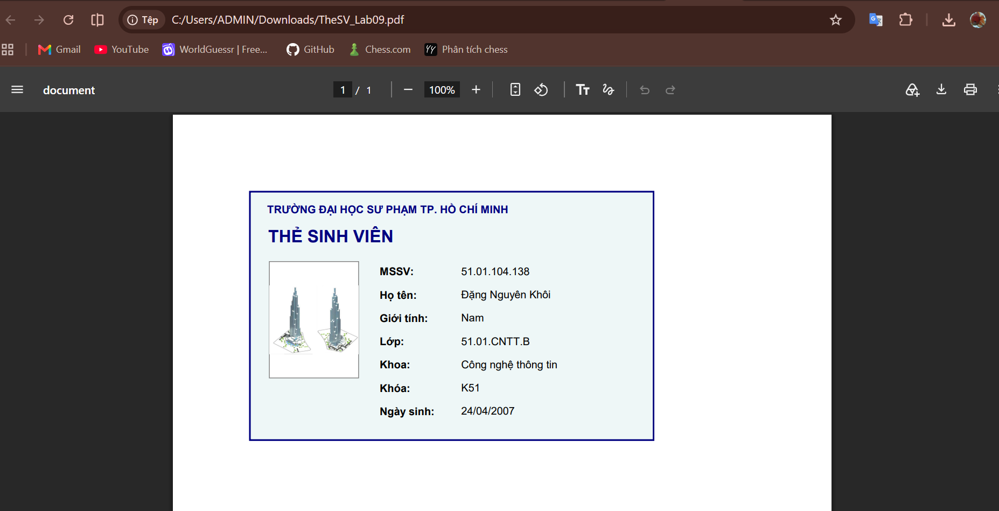

####  10. Làm mới dữ liệu

- **Kết quả:** Thông tin được xóa hoặc trở về lựa chọn ban đầu, ảnh được xóa và preview cập nhật. 

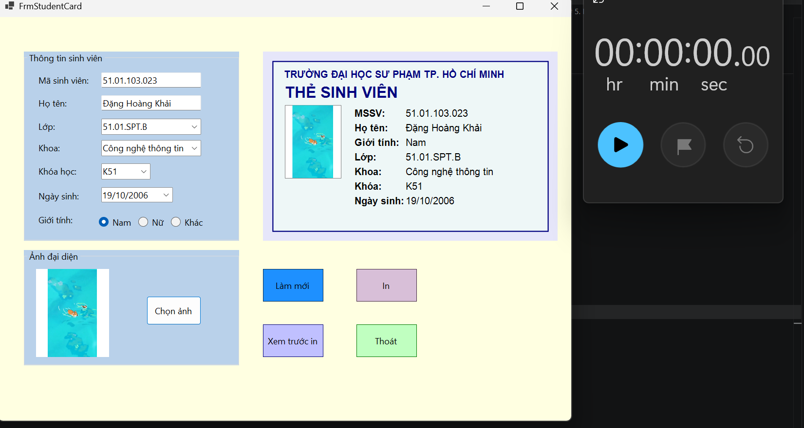
Trước khi làm mới
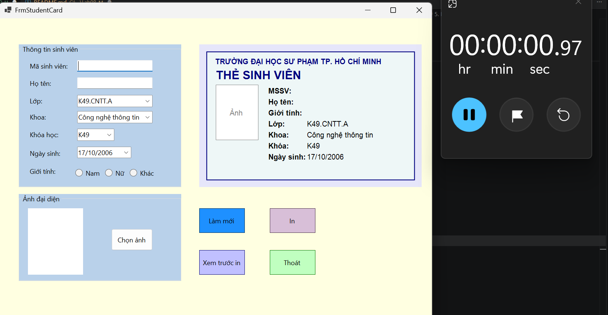
Sau khi làm mới