# COMP1019 – Buổi 10: EduManagerDB

## 1. Thông tin bài lab

- **Môn học:** COMP1019 – Lập trình trên Windows
- **Chủ đề:** Thiết kế và cài đặt cơ sở dữ liệu EduManagerDB bằng SQL Server
- **Công cụ:** SQL Server / SQL Server Management Studio (SSMS)

## 2. Mục tiêu

Xây dựng cơ sở dữ liệu quản lý sinh viên bằng T-SQL; tạo bảng, khóa chính, khóa ngoại và ràng buộc dữ liệu; thêm dữ liệu mẫu; thực hiện truy vấn và kiểm thử các trường hợp nhập dữ liệu không hợp lệ.

## 3. Các tệp SQL

- `01_CreateDatabase.sql`: Tạo database `EduManagerDB` và 6 bảng.
- `02_InsertSampleData.sql`: Thêm dữ liệu mẫu cho các bảng.
- `03_Queries.sql`: Thực hiện các truy vấn, cập nhật, xóa dữ liệu và kiểm thử ràng buộc.

## 5. Dữ liệu mẫu

Dữ liệu được thêm theo thứ tự bảo đảm các khóa ngoại hợp lệ.

| Bảng | Số bản ghi mẫu |
|---|---:|
| `KHOA` | 2 |
| `LOP` | 3 |
| `SINHVIEN` | 7 |
| `MONHOC` | 4 |
| `KETQUA` | 8 |
| `TAIKHOAN` | 2 |

Sinh viên `SV007` được tạo nhưng chưa có kết quả học tập để phục vụ kiểm thử truy vấn xóa sinh viên chưa có điểm.

## 6. Nội dung truy vấn đã thực hiện

1. Liệt kê toàn bộ sinh viên.
2. Liệt kê sinh viên kèm tên lớp và tên khoa bằng `JOIN`.
3. Tìm sinh viên theo một phần họ tên bằng `LIKE`.
4. Liệt kê sinh viên theo mã lớp.
5. Cập nhật họ tên sinh viên.
6. Xóa sinh viên chưa có dữ liệu điểm.
7. Liệt kê điểm từng sinh viên theo từng môn học.
8. Tính điểm trung bình của sinh viên.
9. Thống kê số sinh viên theo từng lớp.
10. Liệt kê các lớp có từ 2 sinh viên trở lên bằng `GROUP BY` và `HAVING`.
11. Kiểm thử khóa ngoại khi thêm sinh viên vào lớp không tồn tại.
12. Kiểm thử ràng buộc điểm khi nhập điểm lớn hơn 10.

## 7. Ảnh chụp minh chứng

### 7.1. Tạo database và các bảng

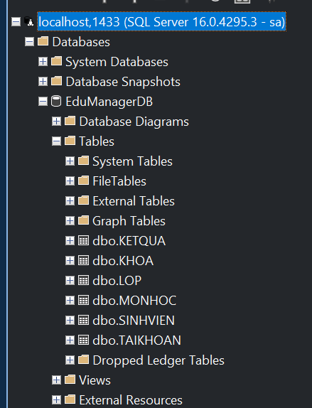

### 7.2. Dữ liệu mẫu sau khi thêm

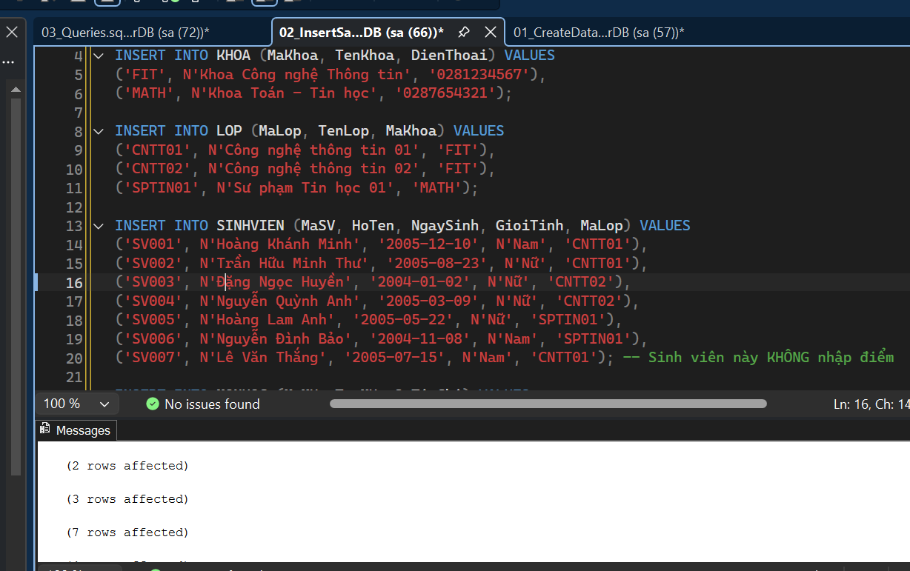
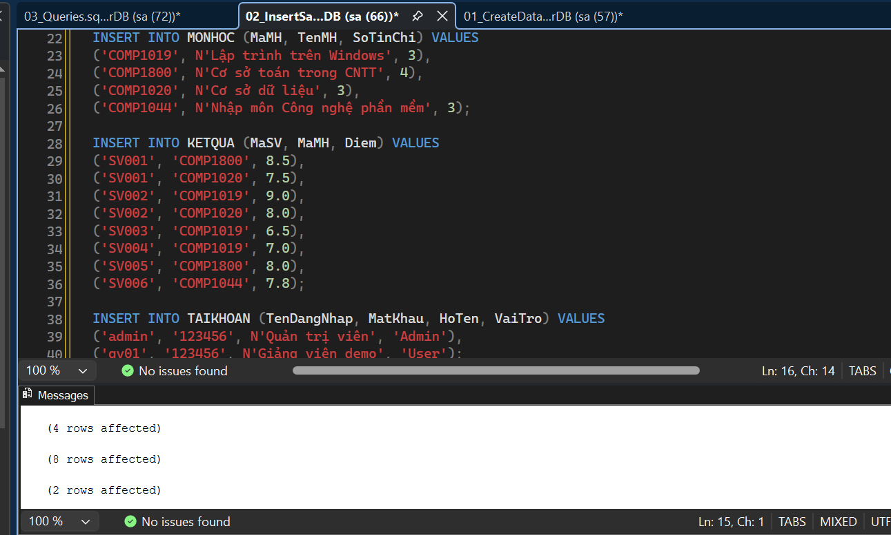

### 7.3. Truy Vấn Join

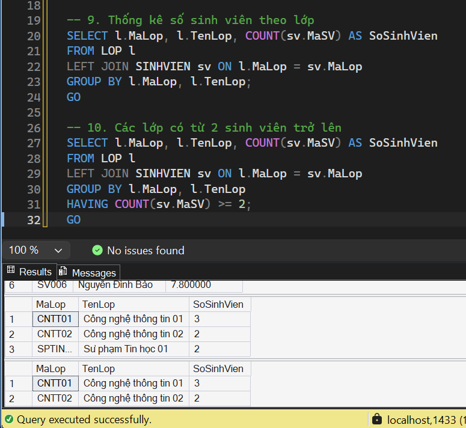
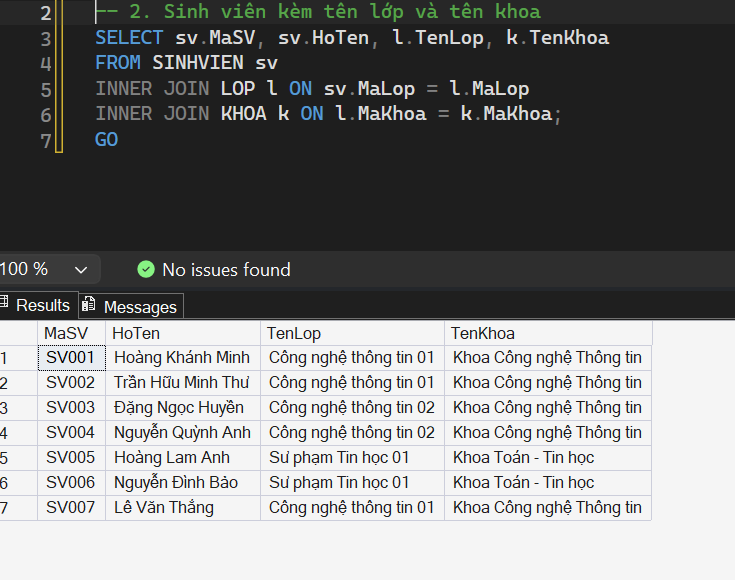

### 7.4. Xóa sinh viên chưa có điểm
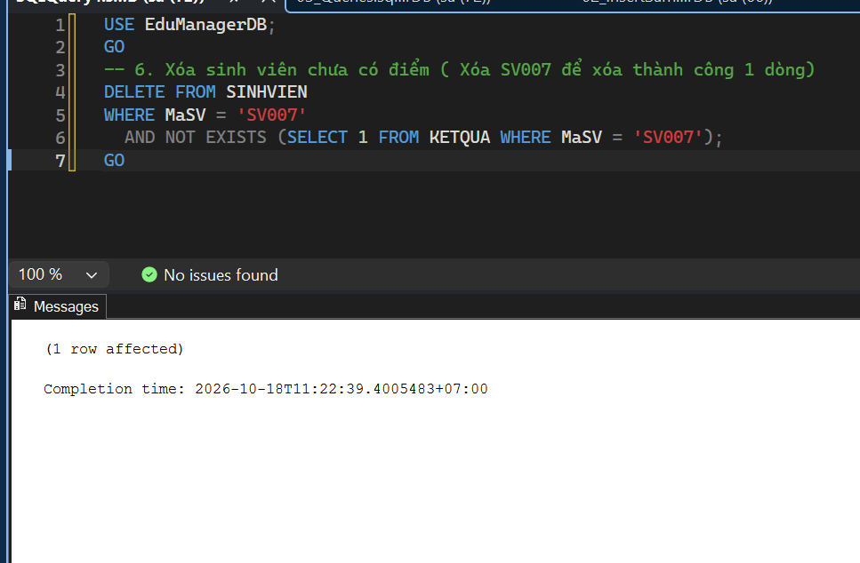

### 7.5. Tính điểm trung bình sinh viên

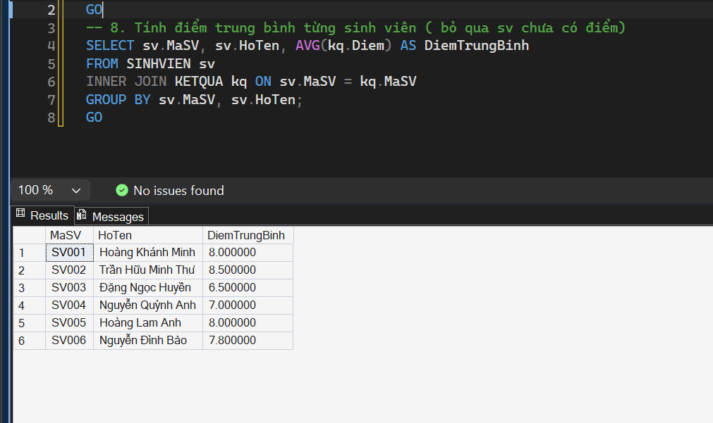

### 7.6. Kiểm thử lỗi khóa ngoại

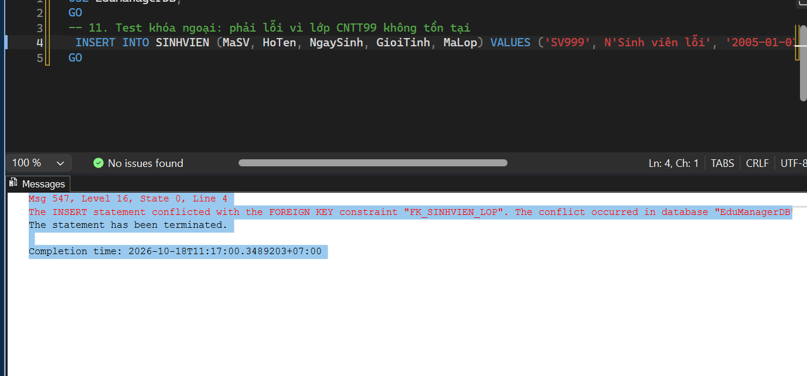

### 7.7. Kiểm thử điểm ngoài khoảng 0–10

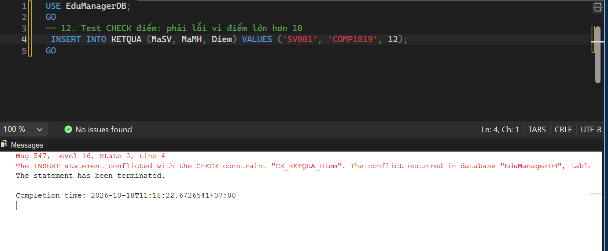

### 7.8. Kiểm thử giới tính không thuộc nam nữ

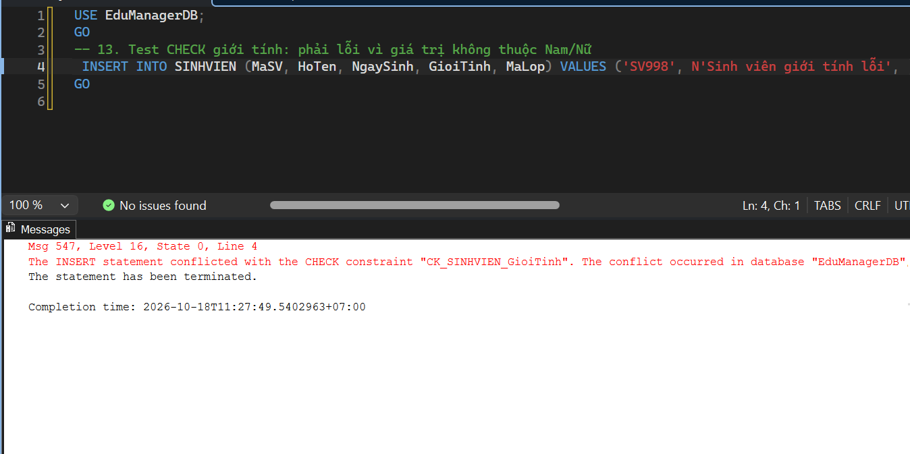

### 7.9. Kiểm thử lỗi khóa chính

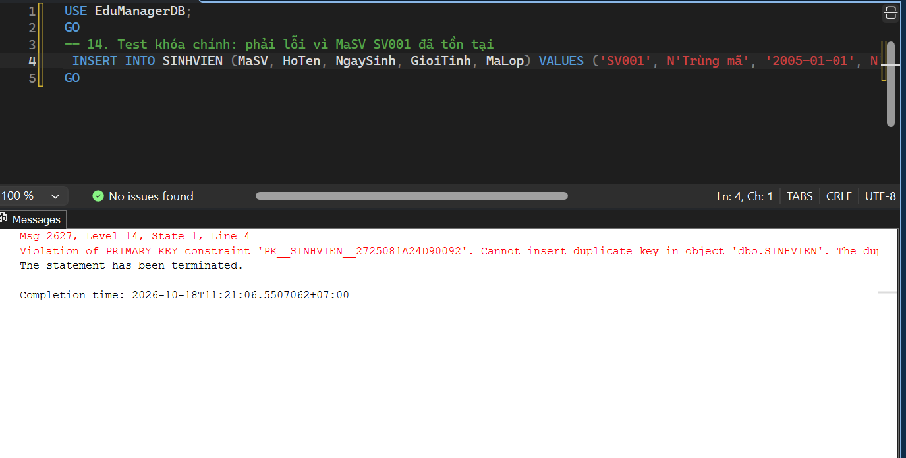

## 8. Kết luận

Bài lab đã xây dựng cơ sở dữ liệu `EduManagerDB` gồm 6 bảng, thiết lập khóa chính, khóa ngoại và các ràng buộc theo yêu cầu. Dữ liệu mẫu đáp ứng số lượng tối thiểu. Các truy vấn được sử dụng để kiểm tra dữ liệu, kết hợp bảng, thống kê, cập nhật, xóa và kiểm thử những trường hợp nhập dữ liệu không hợp lệ.

