# COMP1019 – Buổi 11: ADO.NET và CRUD với SQL Server

**Môn học:** COMP1019 – Lập trình trên Windows   
**Đề tài:** Quản lý lớp học bằng Windows Forms, ADO.NET và SQL Server

## 1. Mục tiêu
- Kết nối Windows Forms với database `EduManagerDB` bằng `Microsoft.Data.SqlClient`.
- Hiển thị danh sách lớp từ bảng `LOP` lên `DataGridView`.
- Thêm, sửa, xóa và tìm kiếm lớp bằng câu SQL có tham số.
- Kiểm tra dữ liệu nhập, mã lớp trùng và không cho xóa lớp đang có sinh viên.

## 2. Chức năng
- Tự động tải danh sách lớp khi mở form.
- Chọn dòng để đưa mã lớp và tên lớp lên ô nhập.
- Thêm lớp và kiểm tra mã lớp trùng.
- Cập nhật tên lớp theo mã lớp.
- Xác nhận trước khi xóa; chặn xóa lớp có sinh viên.
- Tìm kiếm theo mã lớp hoặc tên lớp.
- Làm mới ô nhập và tải lại danh sách.
- Dùng tham số SQL để truyền dữ liệu vào truy vấn.

## 3. Connection String sử dụng

```text
Server=localhost,1433;Database=EduManagerDB;User Id=sa;Password=YourPassword123!;TrustServerCertificate=True
```
> Chuỗi kết nối trên dành cho SQL Server Docker đang chạy ở cổng `1433`. 

## 4. Test case

### Test case 1 – Load Form

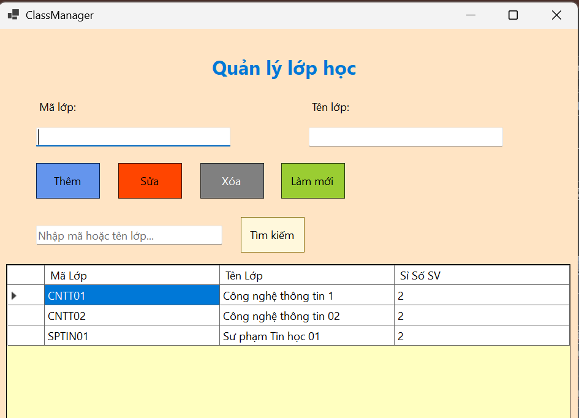

---

### Test case 2 – Thêm lớp hợp lệ

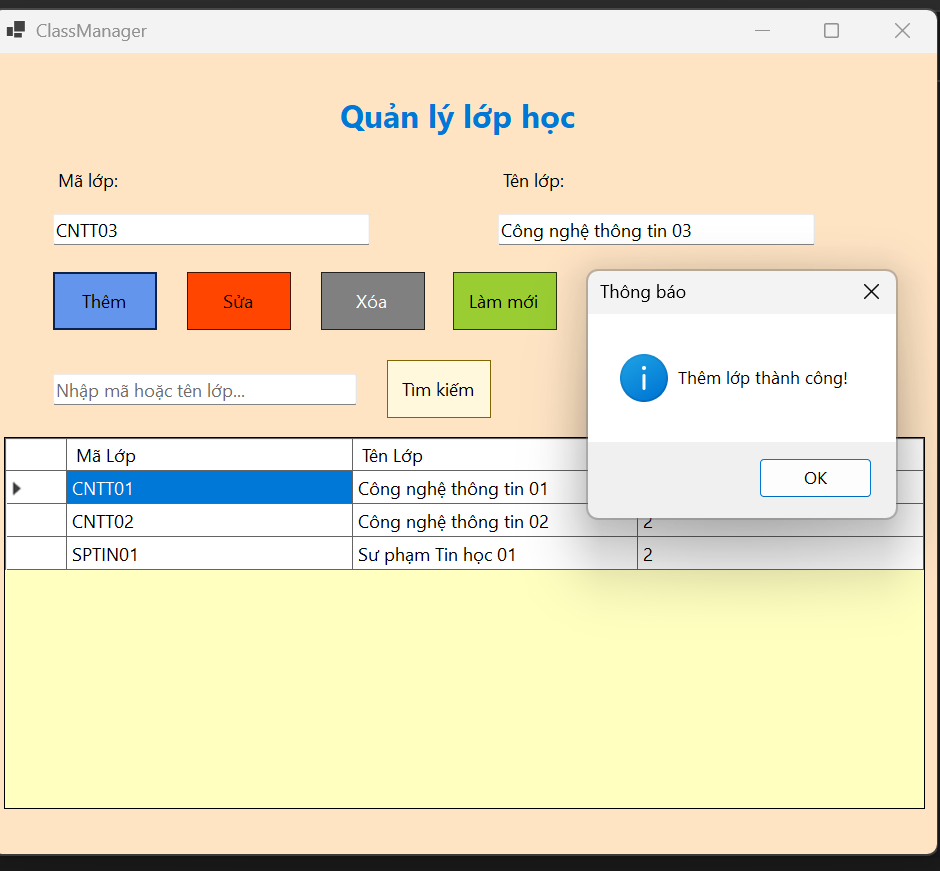
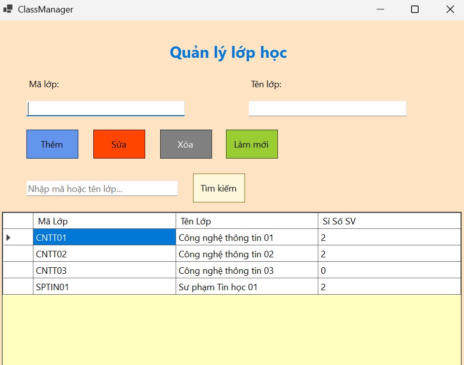
---

### Test case 3 – Thêm lớp thiếu mã

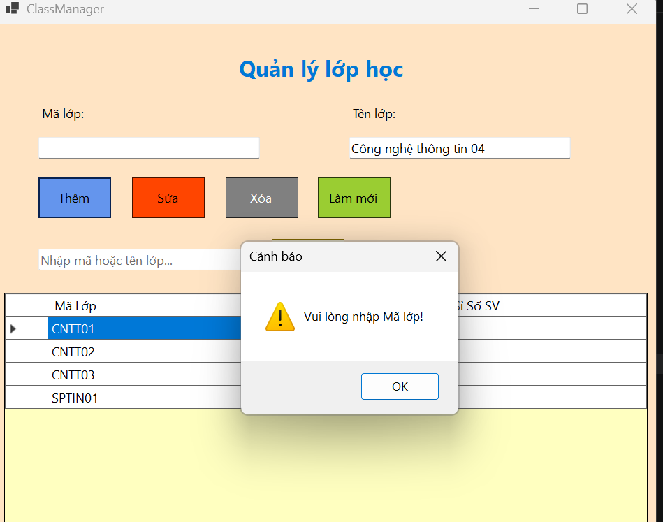

---

### Test case 4 – Thêm lớp trùng mã

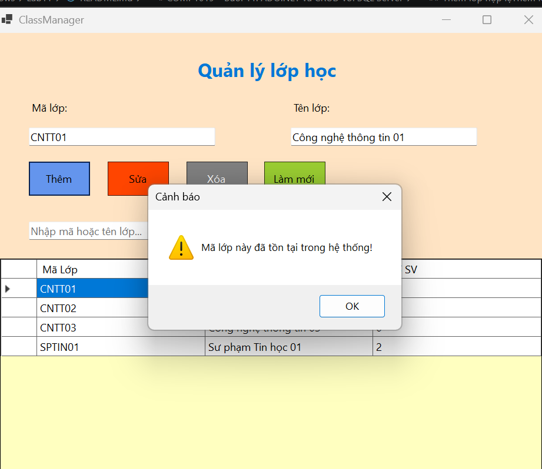

---

### Test case 5 – Sửa lớp hợp lệ

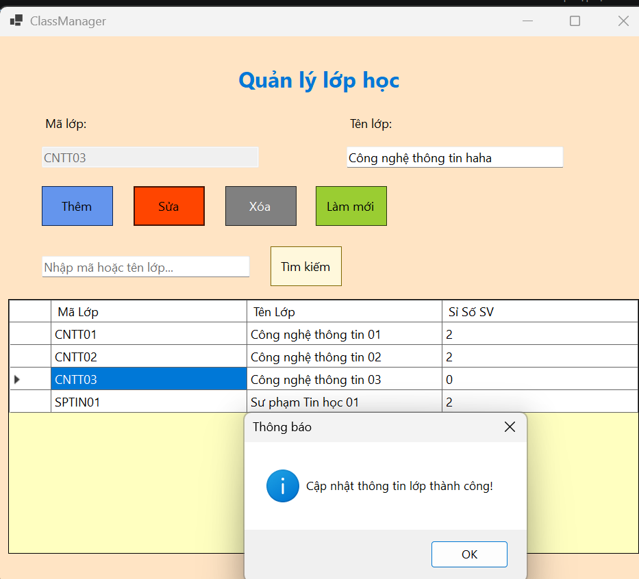
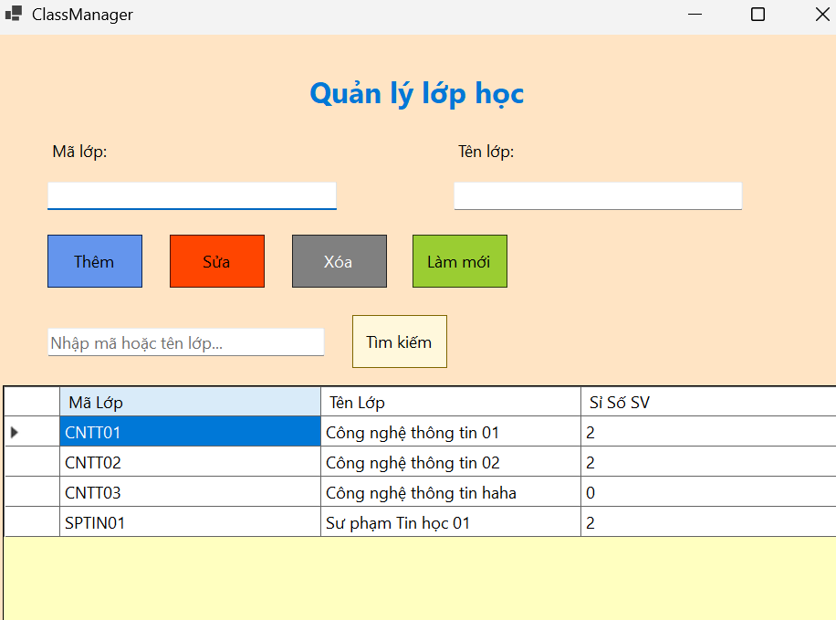

---

### Test case 6 – Xóa lớp chưa có sinh viên

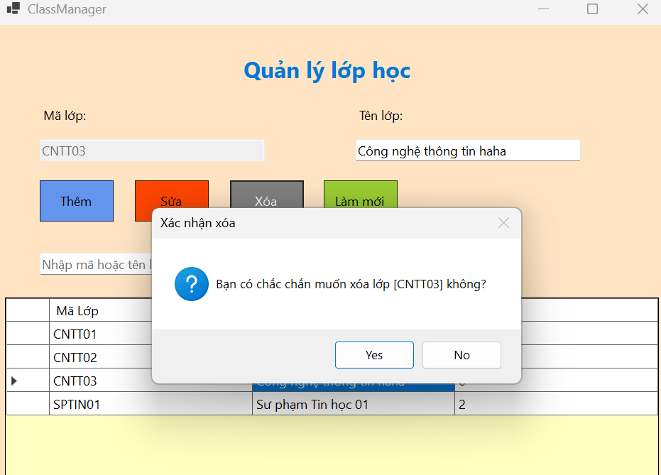
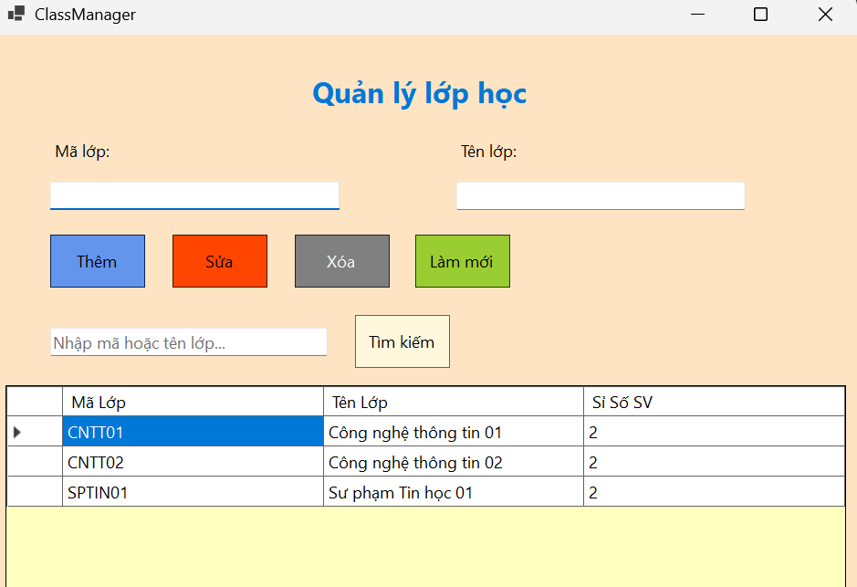

---

### Test case 7 – Xóa lớp đang có sinh viên

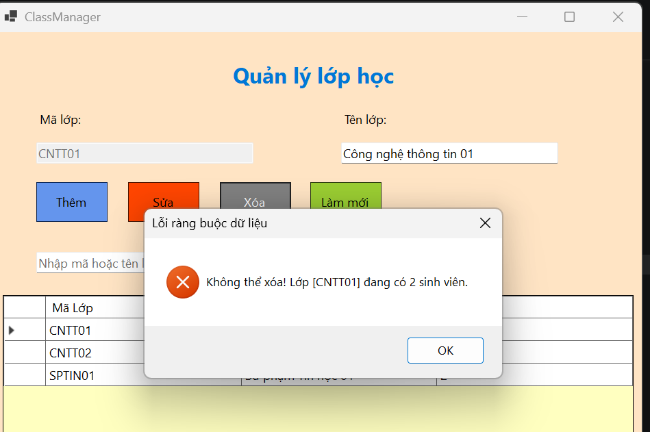

---

### Test case 8 – Tìm kiếm lớp

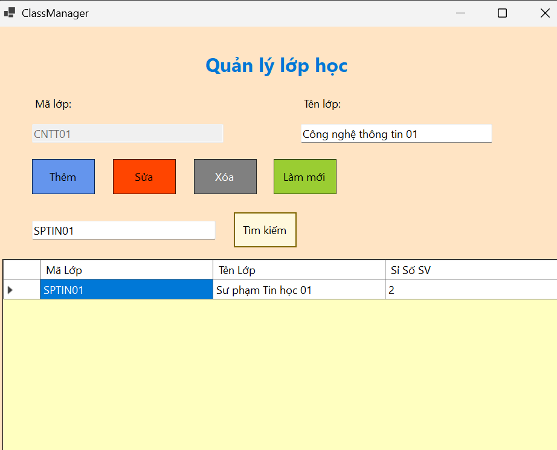
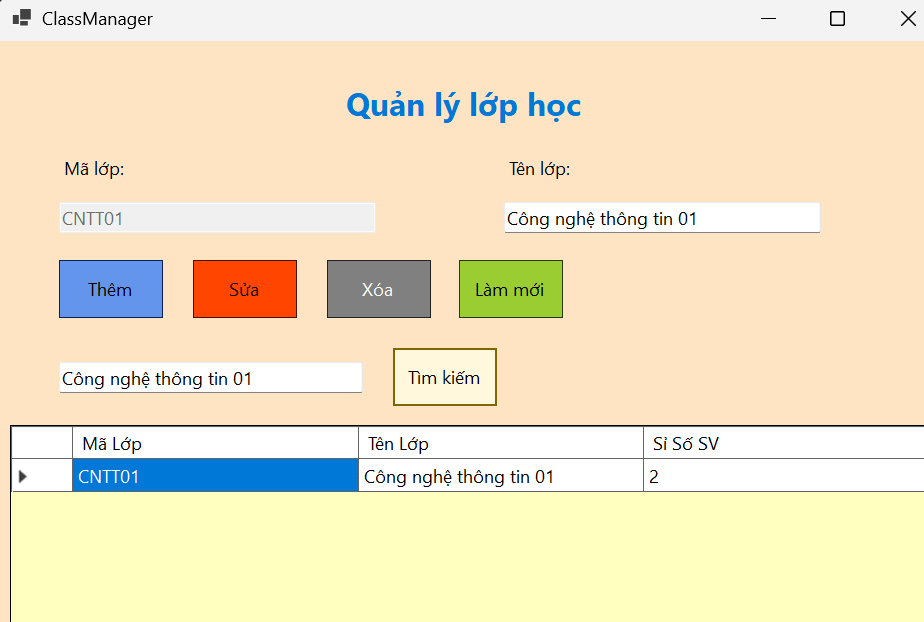

## 7. Tổng kết

Bài lab xây dựng form quản lý lớp học bằng Windows Forms và ADO.NET, kết nối tới SQL Server thông qua `Microsoft.Data.SqlClient`. Dữ liệu được truy vấn trực tiếp từ database `EduManagerDB`, bảng `LOP`, và hiển thị bằng `DataGridView`. Các chức năng CRUD và tìm kiếm sử dụng câu lệnh SQL có tham số. Chương trình kiểm tra dữ liệu bắt buộc, ngăn mã lớp trùng và không cho xóa lớp đang có sinh viên. Kết quả kiểm thử được ghi nhận bằng ảnh minh chứng trong thư mục `images/`.


