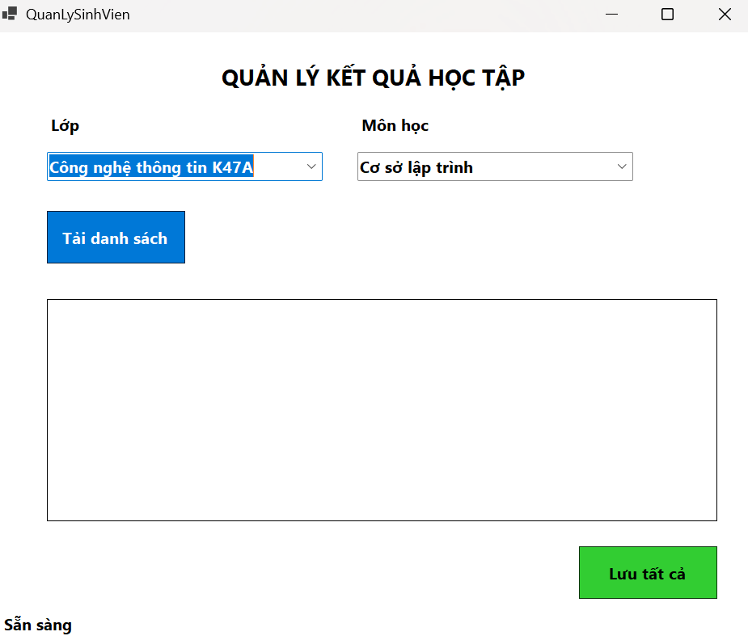
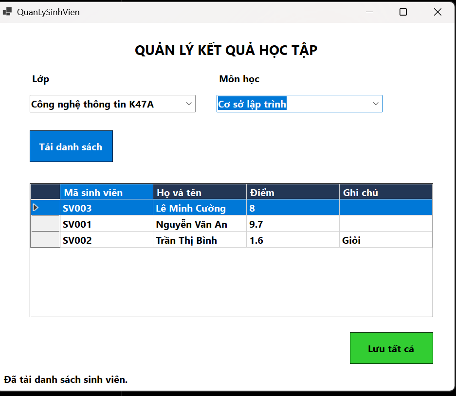
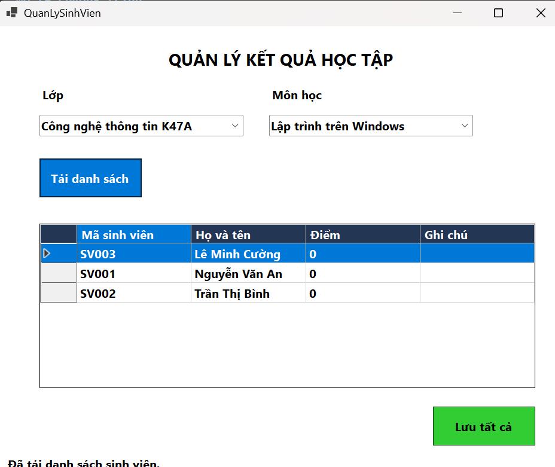
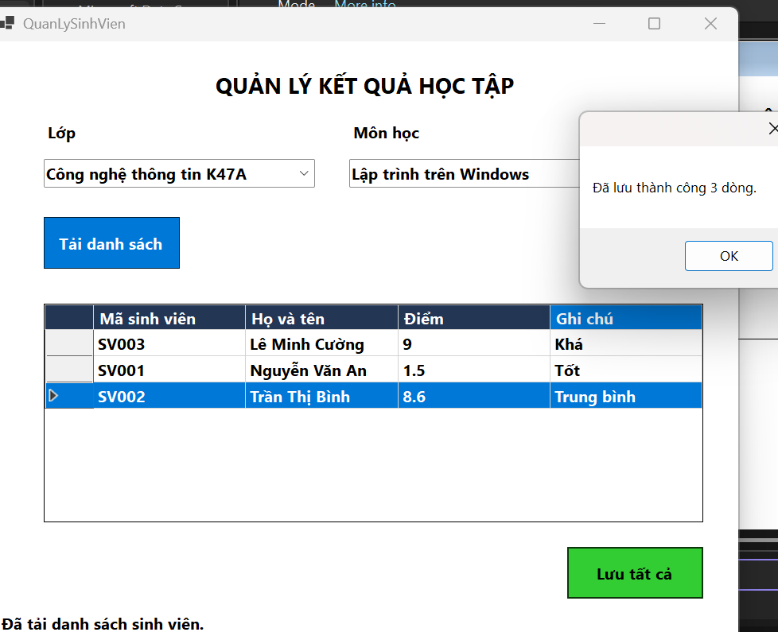
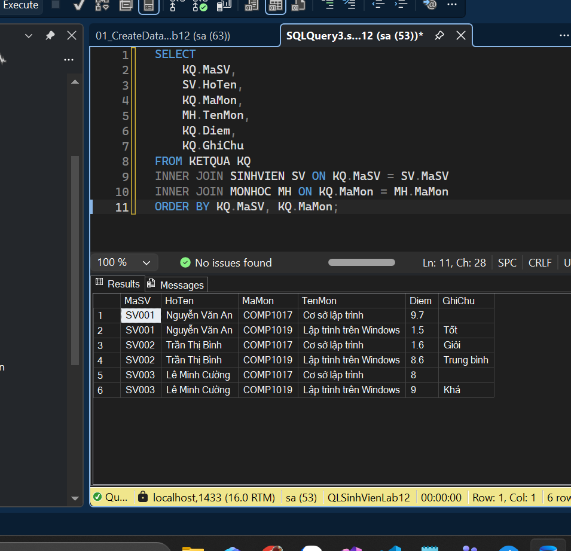
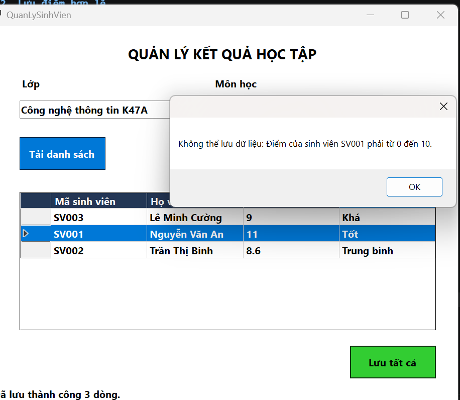

# Lab 12 -- Quản lý kết quả học tập

## 1. Mô tả chương trình

Chương trình WinForms **Quản lý kết quả học tập** hỗ trợ tải danh sách
sinh viên theo lớp và môn học, nhập/cập nhật điểm, ghi chú và lưu kết
quả vào SQL Server.

## 2. Kiểm chứng chức năng

### 2.1 Form khi load 


### 2.2. Tải danh sách theo lớp và môn học

-   Chọn một lớp trong ComboBox **Lớp**.
-   Chọn một môn trong ComboBox **Môn học**.
-   Bấm **Tải danh sách**.
-   Kiểm tra `DataGridView` hiển thị danh sách sinh viên và kết quả
    tương ứng.

 
#### do đã test thử trước nên code có thay đổi về điểm và ghi chú




### 2.3. Lưu điểm hợp lệ

-   Tải danh sách sinh viên.
-   Nhập các điểm hợp lệ trong khoảng `0–10`, ví dụ `8`, `9`, `7`.
-   Bấm **Lưu tất cả** và kiểm tra thông báo thành công.
-   Trong SSMS, chạy:

``` sql
SELECT
    KQ.MaSV,
    SV.HoTen,
    KQ.MaMon,
    MH.TenMon,
    KQ.Diem,
    KQ.GhiChu
FROM KETQUA KQ
INNER JOIN SINHVIEN SV ON KQ.MaSV = SV.MaSV
INNER JOIN MONHOC MH ON KQ.MaMon = MH.MaMon
ORDER BY KQ.MaSV, KQ.MaMon;
```

-   Đối chiếu kết quả trong bảng `KETQUA` với điểm vừa lưu trên form.






### 2.4. Kiểm tra điểm không hợp lệ

-   Tải danh sách sinh viên.
-   Nhập điểm ngoài khoảng cho phép, ví dụ `-11` hoặc `11`.
-   Bấm **Lưu tất cả**.
-   Chương trình phải hiển thị thông báo lỗi và không thực hiện thao tác
    lưu.


## 3. Kết luận

Chương trình minh họa việc liên kết dữ liệu trong WinForms bằng
`DataTable` và `BindingSource`, thao tác với SQL Server qua ADO.NET, sử
dụng Stored Procedure và transaction để lưu kết quả học tập. Các kiểm
thử cần đối chiếu cả thông báo trên form và dữ liệu thực tế trong bảng
`KETQUA`.

