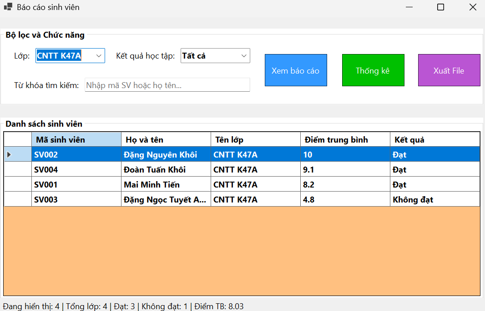
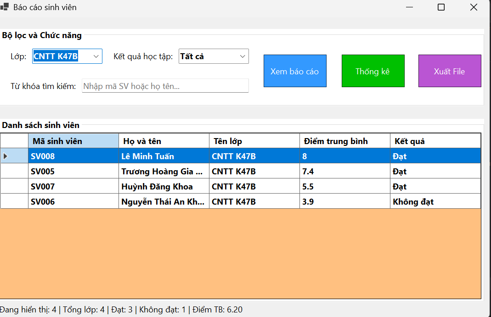
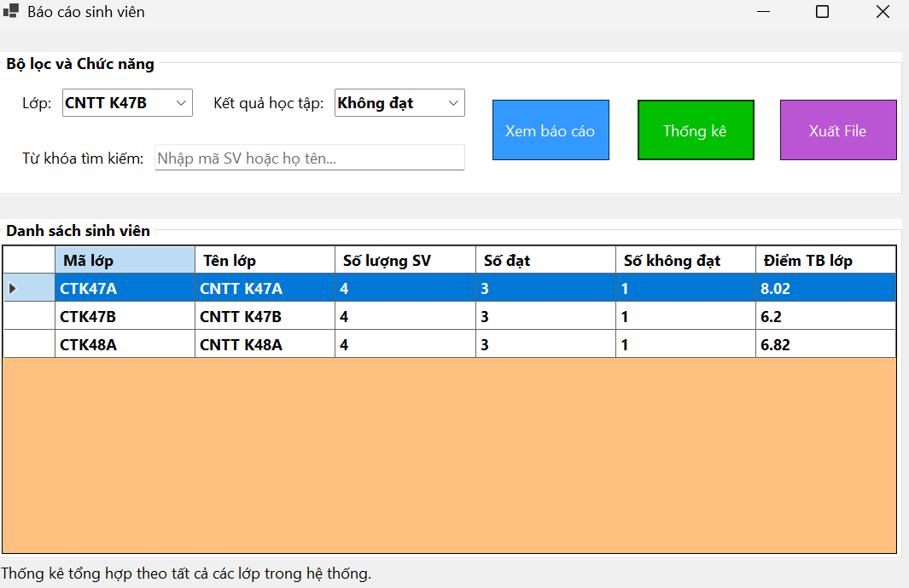
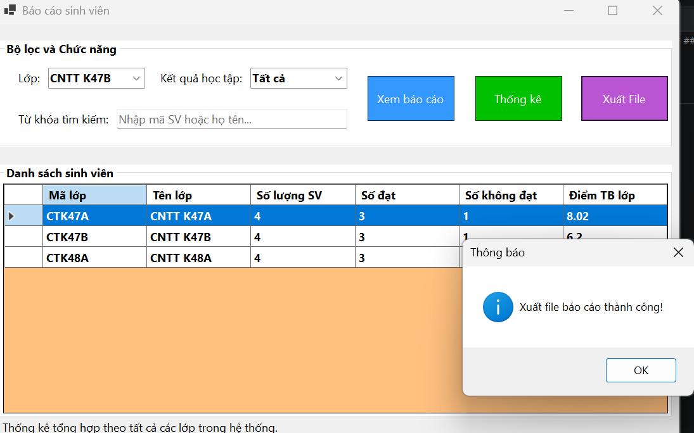
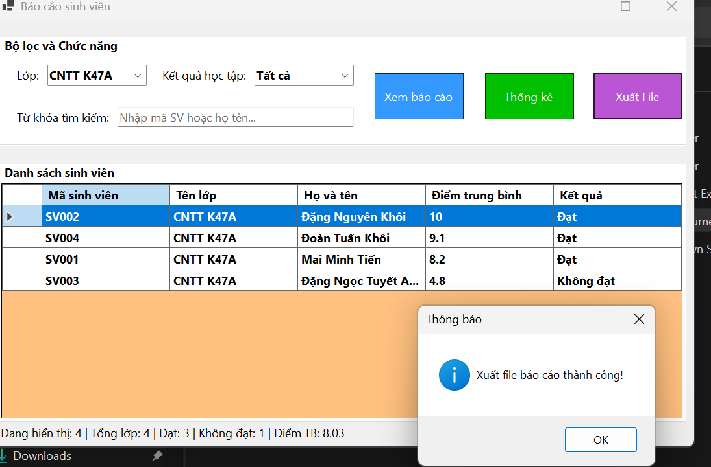
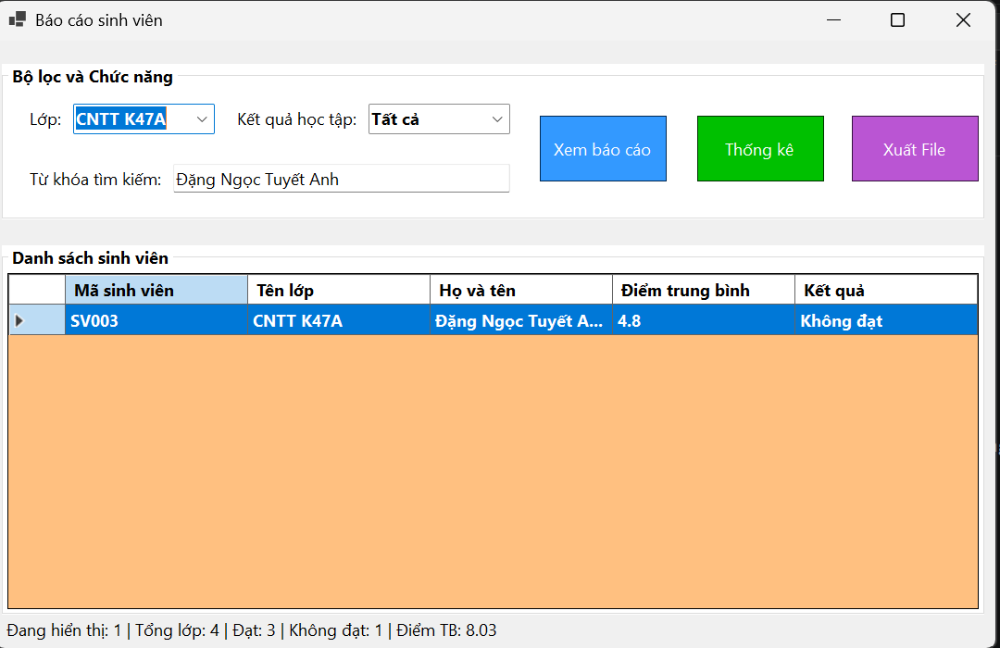
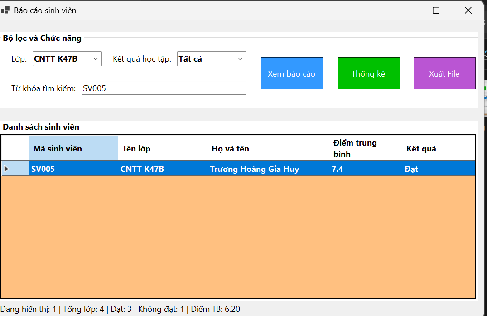
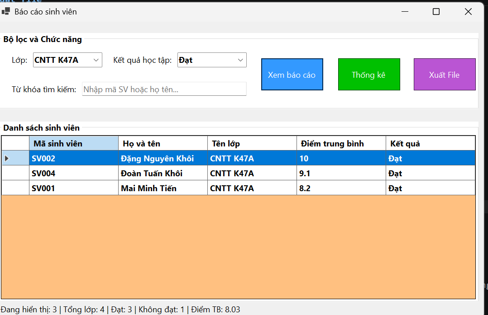
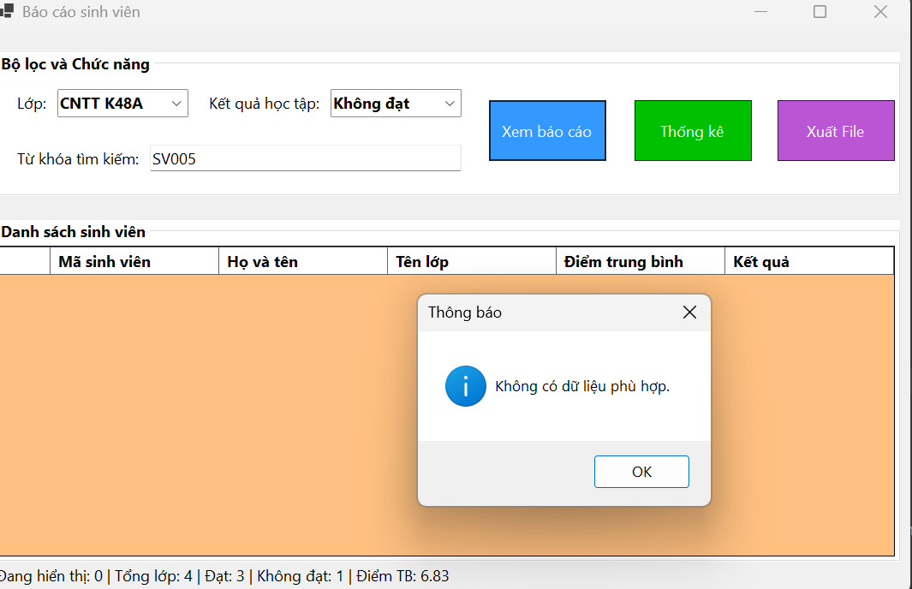

# LAB 13 – BÁO CÁO SINH VIÊN BẰNG LINQ

## 1. Mục tiêu

- Thực hành lọc, sắp xếp, nhóm và thống kê dữ liệu bằng LINQ.
- Hiển thị báo cáo sinh viên bằng `DataGridView`.
- Xuất dữ liệu đang hiển thị ra file CSV hoặc TXT.
- Xử lý trường hợp không có dữ liệu và lỗi khi xuất file.

## 2. Chức năng theo yêu cầu

- Chọn lớp bằng `cboLop`.
- Lọc kết quả học tập bằng `cboKetQua`: Tất cả, Đạt, Không đạt.
- Tìm theo mã sinh viên hoặc họ tên bằng `txtTuKhoa`.
- Nút `btnXemBaoCao`: lọc dữ liệu và sắp xếp điểm giảm dần.
- Nút `btnThongKe`: nhóm sinh viên theo lớp, thống kê số lượng và điểm trung bình.
- Nút `btnXuatFile`: xuất dữ liệu đang hiển thị ra CSV hoặc TXT.
- Hiển thị tổng số sinh viên, số đạt, số không đạt và điểm trung bình.
- Thông báo khi không có dữ liệu phù hợp; xử lý ngoại lệ khi xuất file.

## 3. Cấu trúc project(tham khảo)

```text
BaoCaoSinhVien/
├── Models/
│   └── SinhVien.cs
├── Forms/
│    └── FrmBaoCaoSinhVien.cs
├── Program.cs
├── images/
│   ├── ....png
│   ├── ....png
├── BaoCaoSinhVien.txt
├── BaoCaoSinhVien.csv
└── README.md
```

## 4. Model `SinhVien`

Lớp `SinhVien` gồm các thuộc tính:

- `MaSV`: mã sinh viên.
- `HoTen`: họ tên sinh viên.
- `MaLop`: mã lớp.
- `TenLop`: tên lớp.
- `Diem`: điểm trung bình.
- `KetQua`: thuộc tính chỉ đọc, trả về **Đạt** nếu `Diem >= 5`, ngược lại trả về **Không đạt**.

## 5. Ảnh minh chứng

### 5.1. Chạy chương trình và hiển thị dữ liệu

Sau khi chạy chương trình bằng `F5`


#### Đối với lớp CNTT K47A


#### Đối với lớp CNTT K47B


### 5.2. Thống kê theo lớp

Bấm **Thống kê** để hiển thị số lượng sinh viên và điểm trung bình của từng lớp. 



### 5.3. Xuất file

Bấm **Xuất File**, lưu báo cáo dạng CSV hoặc TXT. Chụp ảnh thông báo xuất thành công hoặc mở file đã xuất.


#### Đây là ảnh xuất ra file .csv


#### Đây là ảnh xuất ra file .txt

### 5.4. Tìm kiếm

Tìm kiếm trên thanh tìm kiếm, có thể nhập họ tên hoặc mã sinh viên

#### Ảnh tìm theo họ tên


#### Ảnh tìm theo mã SV

### 5.5 Lọc dữ liệu

#### Lọc lớp là CNTT K47A và kết quả học tập đạt


#### Lọc lớp là CNTT K48A và kết quả học tập không đạt kèm theo tìm mã sinh viên SV005 cho ra kết quả không tìm thấy dữ liệu phù hợp

## 6. Kết luận

Bài thực hành xây dựng Form báo cáo sinh viên, hỗ trợ lọc và tìm kiếm dữ liệu, sắp xếp theo điểm, thống kê theo lớp và xuất kết quả ra file. Các ảnh minh chứng và file báo cáo xuất ra cần được bổ sung sau khi chạy kiểm thử thực tế.
