# LAB 14 – ENTITY FRAMEWORK VÀ MÔ HÌNH BA LỚP

## 1. Mục tiêu

- Tạo Entity và `DbContext` để làm việc với bảng môn học.
- Thực hiện các chức năng thêm, sửa, xóa và tìm kiếm bằng Entity Framework Core.
- Tổ chức mã nguồn theo mô hình ba lớp GUI, BLL và DAL.
- Thực hiện validation và xử lý lỗi trong quá trình thao tác.

## 2. Chức năng theo yêu cầu

- Hiển thị danh sách môn học khi mở Form.
- Thêm môn học mới.
- Sửa thông tin môn học đã chọn.
- Xóa môn học sau khi người dùng xác nhận bằng `MessageBox`.
- Tìm kiếm môn học theo mã hoặc tên.
- Chọn một dòng trên `DataGridView` để hiển thị thông tin lên các control nhập liệu.
- Làm mới Form và tải lại danh sách môn học.

## 3. Cấu trúc project (tham khảo)

```text
EduManager/
├── Models/
│   └── MonHoc.cs
├── Data/
│   └── EduManagerContext.cs
├── DAL/
│   └── MonHocDAL.cs
├── BLL/
│   └── MonHocBLL.cs
├── GUI/
│   └── FrmMonHoc.cs
├── Database/
│   ├── 01_CreateDatabase.sql
│   └── 02_InsertSampleData.sql
├── images/
│   └── ... .png
├── Program.cs
└── README.md
```

## 4. Entity `MonHoc` và DbContext

### 4.1. Entity `MonHoc`

Lớp `MonHoc` ánh xạ với bảng `MONHOC`, gồm các thuộc tính:

- `MaMonHoc`: mã môn học, khóa chính, tối đa 10 ký tự.
- `TenMonHoc`: tên môn học, bắt buộc, tối đa 100 ký tự.
- `SoTinChi`: số tín chỉ, từ 1 đến 6.
- `TrangThai`: trạng thái còn sử dụng hoặc ngừng sử dụng.

### 4.2. DbContext

Lớp `EduManagerContext` kế thừa `DbContext`, khai báo `DbSet<MonHoc>` và cấu hình kết nối SQL Server bằng Entity Framework Core.

Database sử dụng trong bài làm: `EduManagerDB_V2`.

## 5. Mô hình ba lớp và validation

### 5.1. GUI – Giao diện

`FrmMonHoc` nhận dữ liệu từ các control, gọi phương thức của BLL và hiển thị kết quả. Form không viết câu lệnh SQL và không xử lý toàn bộ logic nghiệp vụ.

### 5.2. BLL – Xử lý nghiệp vụ

`MonHocBLL` kiểm tra dữ liệu trước khi gọi DAL:

- Mã môn học không được rỗng và không vượt quá 10 ký tự.
- Tên môn học không được rỗng và không vượt quá 100 ký tự.
- Số tín chỉ phải nằm trong khoảng từ 1 đến 6.
- Không cho thêm môn học có mã đã tồn tại.
- Kiểm tra môn học tồn tại trước khi sửa hoặc xóa.

### 5.3. DAL – Truy cập dữ liệu

`MonHocDAL` sử dụng Entity Framework Core để truy vấn, thêm, sửa, xóa và tìm kiếm dữ liệu trong bảng `MONHOC`.

### 5.4. Xử lý lỗi và xác nhận xóa

- Khi dữ liệu không hợp lệ hoặc thao tác thất bại, GUI hiển thị thông báo dễ hiểu bằng `MessageBox`.
- Khi xóa môn học, GUI hỏi xác nhận bằng `MessageBox` trước khi gọi BLL.
- `NumericUpDown` giới hạn số tín chỉ từ 1 đến 6; BLL vẫn kiểm tra lại để bảo đảm dữ liệu hợp lệ.

## 6. Test case và ảnh minh chứng

### 6.1. Mở Form

**Tình huống kiểm tra:** Mở Form `FrmMonHoc`.

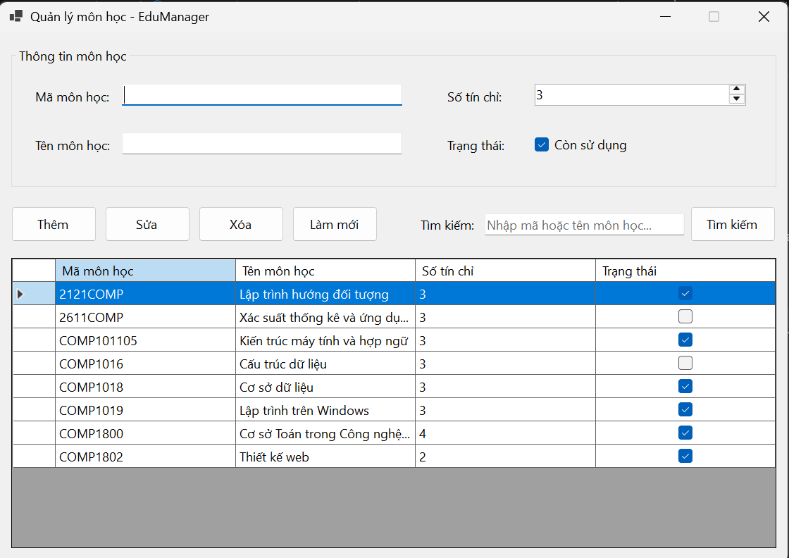

### 6.2. Thêm môn học với dữ liệu hợp lệ

**Tình huống kiểm tra:** Nhập mã môn học, tên môn học, số tín chỉ và trạng thái hợp lệ, sau đó bấm **Thêm**.

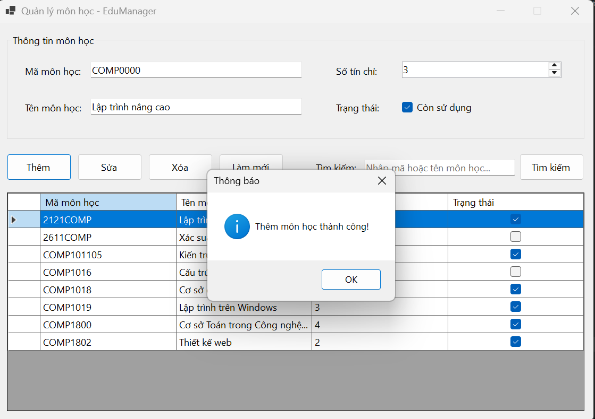

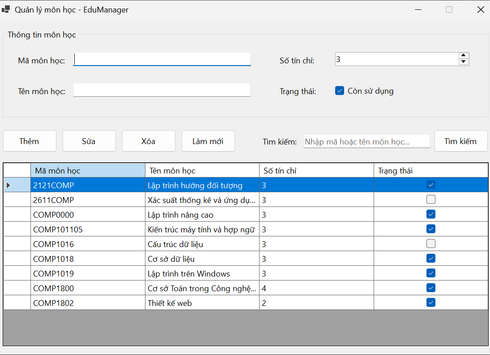

### 6.3. Thêm mã môn học đã tồn tại

**Tình huống kiểm tra:** Nhập mã môn học đã có trong database rồi bấm **Thêm**.

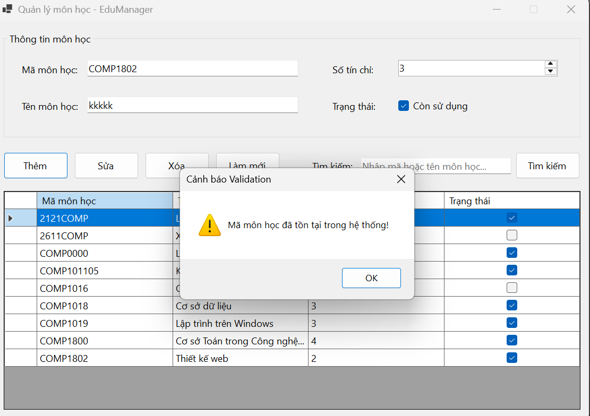

### 6.4. Để trống mã môn học, tên môn học

**Tình huống kiểm tra:** Để trống mã và tên môn học rồi bấm **Thêm**.

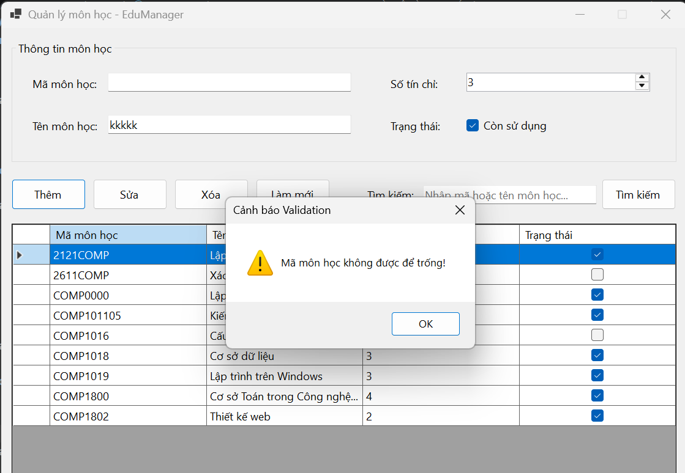
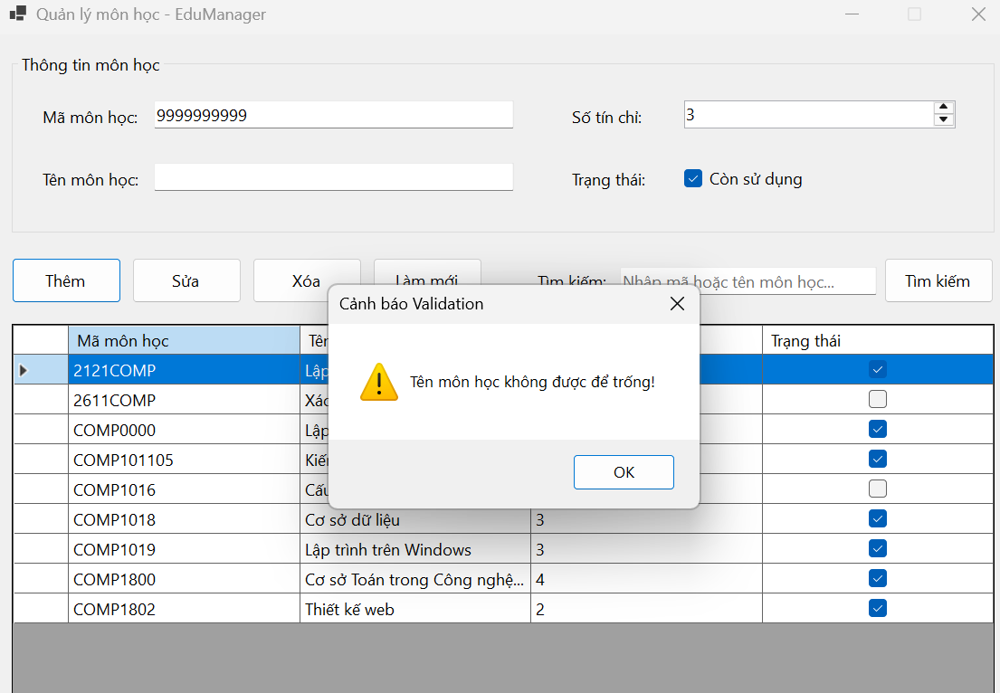

### 6.5. Kiểm tra số tín chỉ từ 1 đến 6

**Tình huống kiểm tra:** Thử nhập số tín chỉ ngoài khoảng từ 1 đến 6.

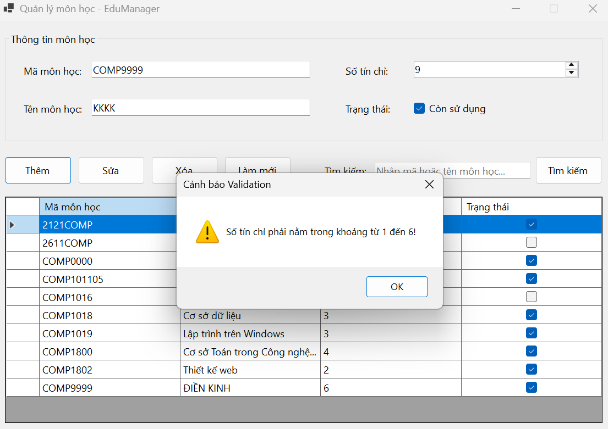

### 6.6. Sửa thông tin môn học

**Tình huống kiểm tra:** Chọn một môn học, thay đổi thông tin rồi bấm **Sửa**.

**Kết quả mong đợi:** Thông tin môn học được cập nhật thành công.

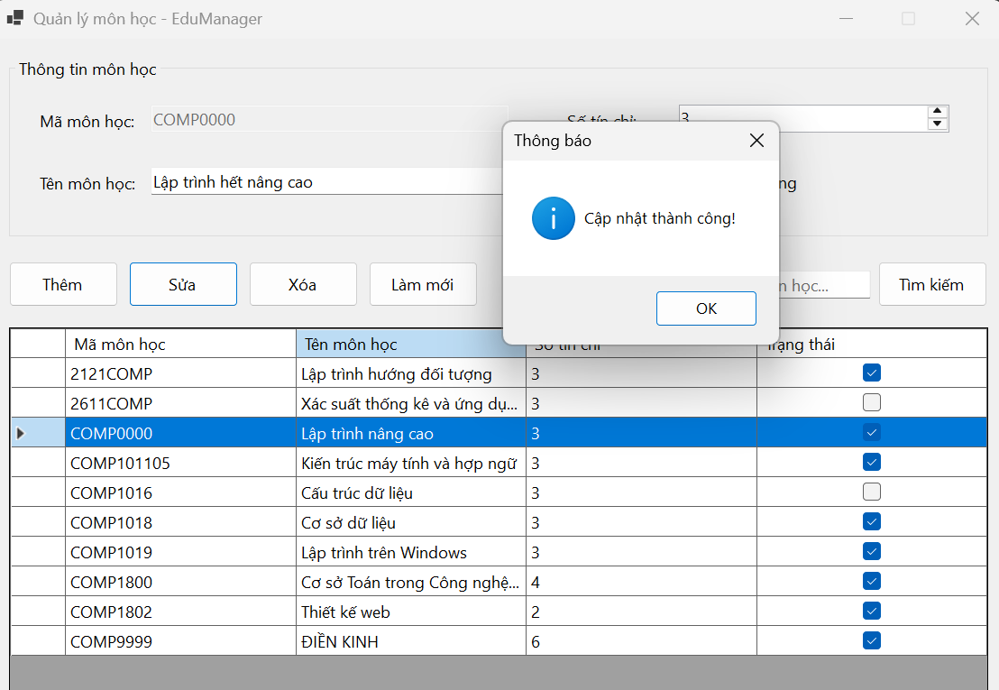
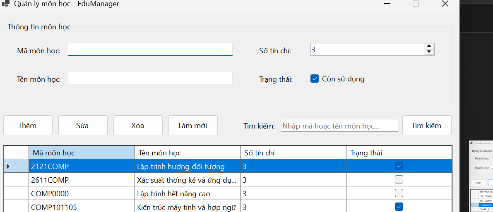

### 6.7. Nhấn Xóa 

**Tình huống kiểm tra:** Chọn môn học cần xóa, bấm **Xóa** 

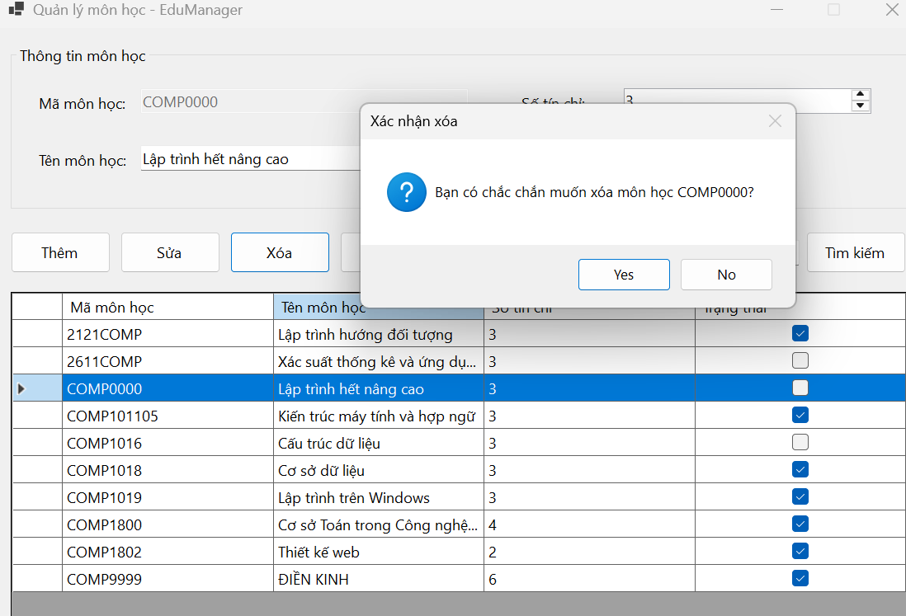
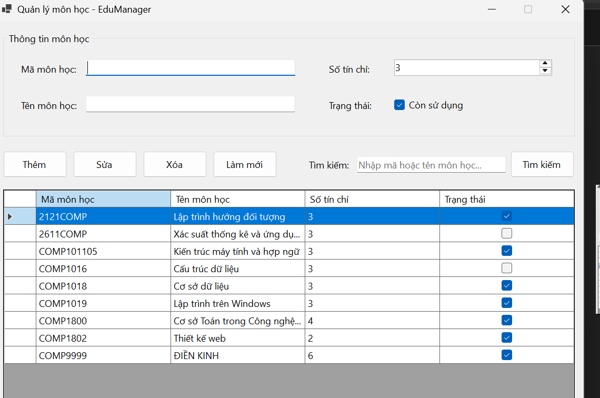

### 6.8. Tìm kiếm bằng mã hoặc tên môn học

**Tình huống kiểm tra:** Nhập mã môn học hoặc tên môn học rồi bấm **Tìm kiếm**.

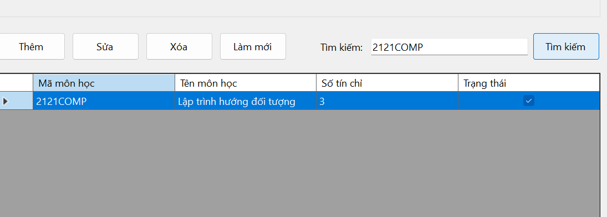
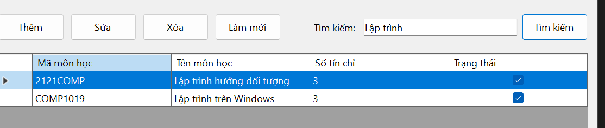

### 6.9. Làm mới Form

**Tình huống kiểm tra:** Nhập dữ liệu vào các control hoặc thực hiện tìm kiếm, sau đó bấm **Làm mới**.

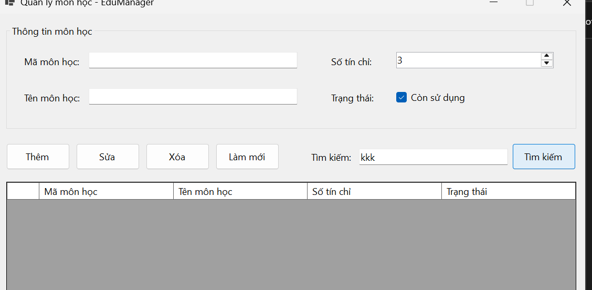
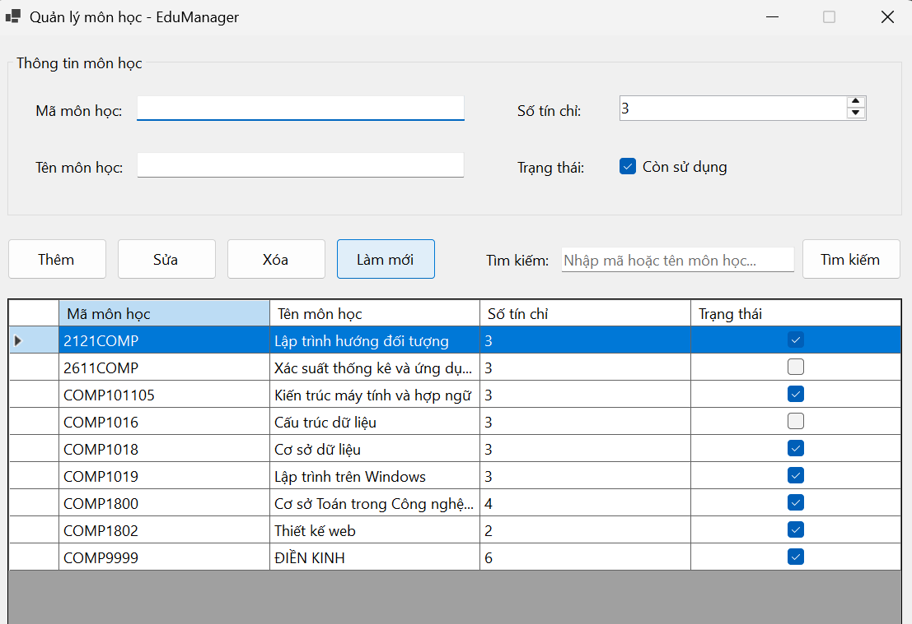

## 7. Câu hỏi nộp kèm

### 7.1. Vì sao không nên viết toàn bộ code CRUD trong sự kiện Button Click?

Không nên viết toàn bộ code CRUD trong sự kiện Button Click vì Form sẽ chứa quá nhiều xử lý, khó đọc, khó sửa lỗi và khó bảo trì. Khi tách GUI, BLL và DAL, mỗi lớp đảm nhận một nhiệm vụ riêng nên mã nguồn rõ ràng và dễ mở rộng hơn.

### 7.2. BLL và DAL khác nhau ở điểm nào?

- **BLL (Business Logic Layer):** xử lý nghiệp vụ và kiểm tra dữ liệu hợp lệ trước khi thực hiện thao tác.
- **DAL (Data Access Layer):** chịu trách nhiệm truy cập và thao tác dữ liệu trong database bằng Entity Framework Core.

### 7.3. Entity Framework khác ADO.NET ở điểm nào?

Entity Framework là ORM, cho phép làm việc với dữ liệu thông qua các class Entity và LINQ, giảm việc phải tự viết nhiều câu lệnh SQL. ADO.NET thường yêu cầu lập trình viên chủ động tạo kết nối, câu lệnh SQL, tham số và xử lý dữ liệu thông qua các đối tượng như `SqlConnection`, `SqlCommand` và `SqlDataReader`.

### 7.4. Trong bài lab này, validation nào nên đặt ở BLL?

Các kiểm tra nghiệp vụ nên đặt ở BLL gồm: mã môn học không được rỗng, tên môn học không được rỗng, số tín chỉ phải từ 1 đến 6, mã môn học không được trùng khi thêm và môn học phải tồn tại khi sửa hoặc xóa. GUI có thể giới hạn nhập liệu để hỗ trợ người dùng, nhưng BLL vẫn phải kiểm tra lại dữ liệu.

## 8. Kết luận

Bài thực hành xây dựng module Quản lý môn học bằng Windows Forms và Entity Framework Core theo mô hình ba lớp. Chương trình thực hiện các chức năng CRUD, tìm kiếm, validation và xử lý lỗi. Các ảnh minh chứng cần được bổ sung sau khi chạy và kiểm thử chương trình thực tế.
