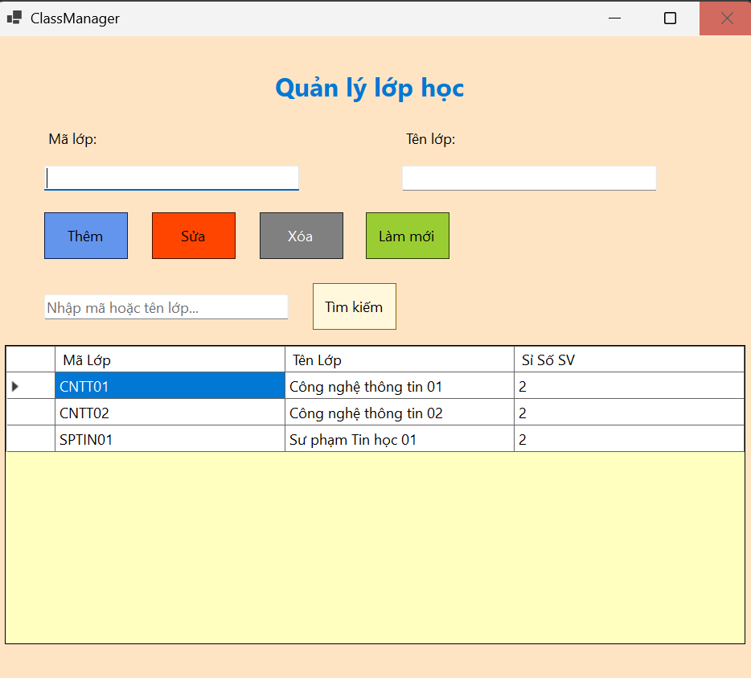
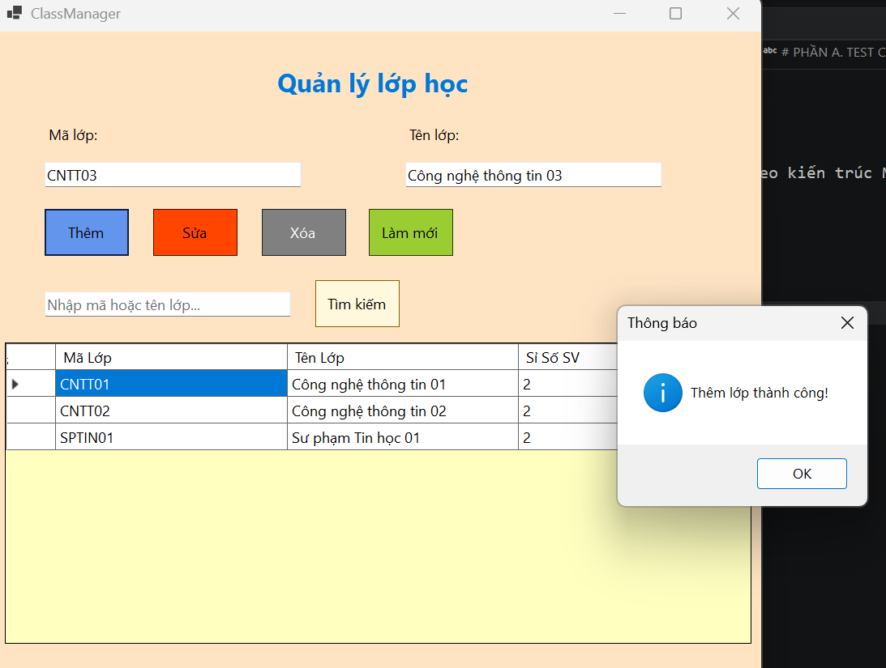
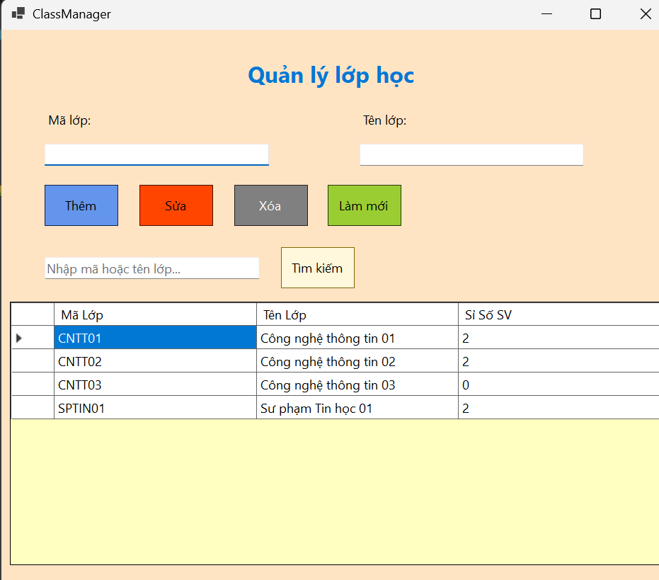
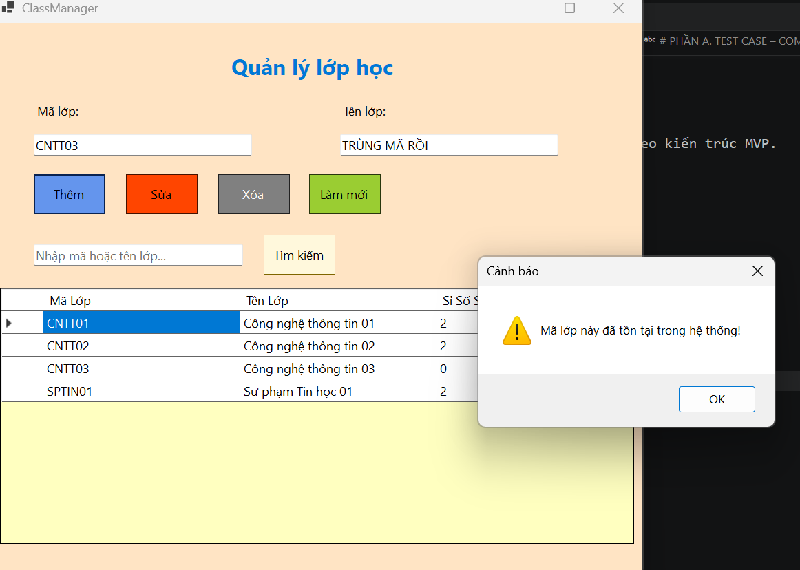
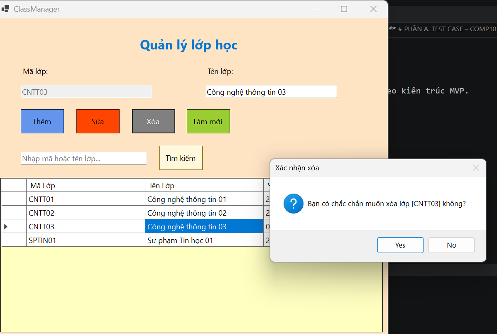
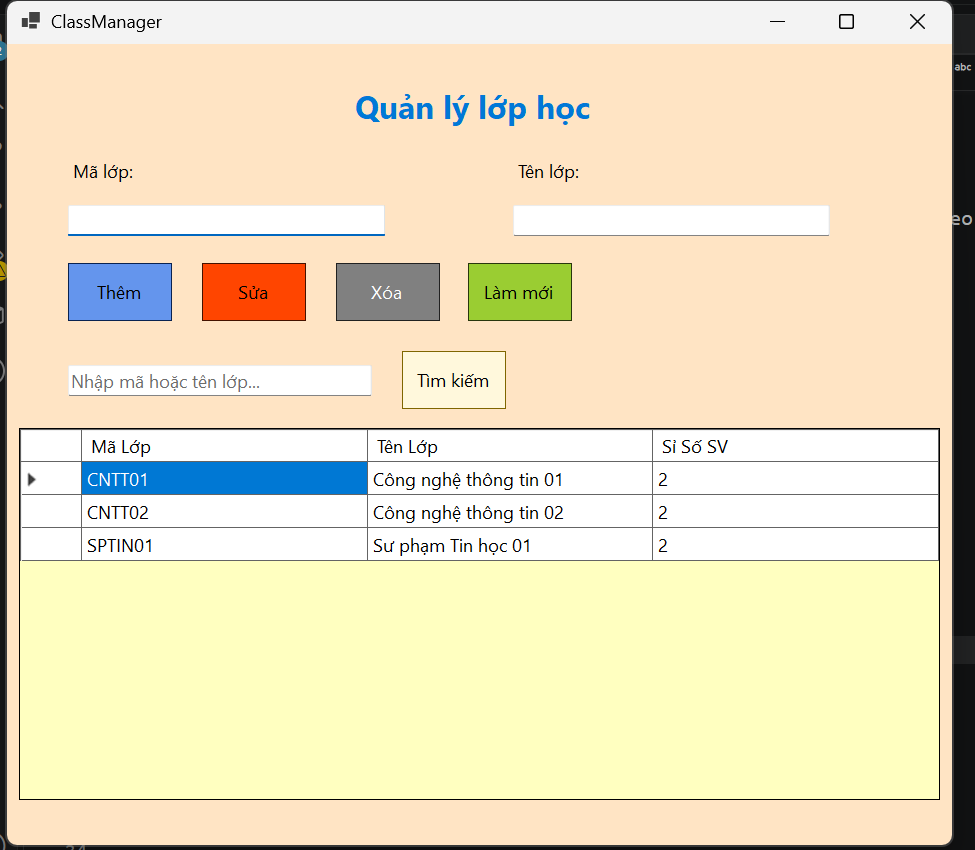
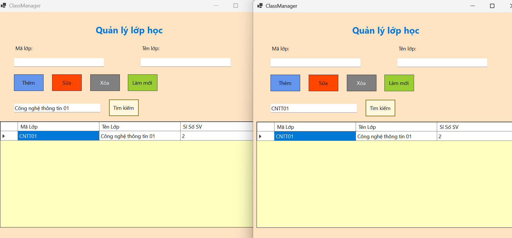
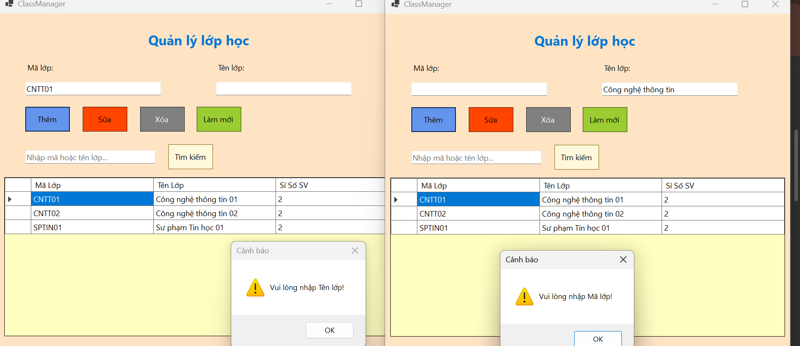
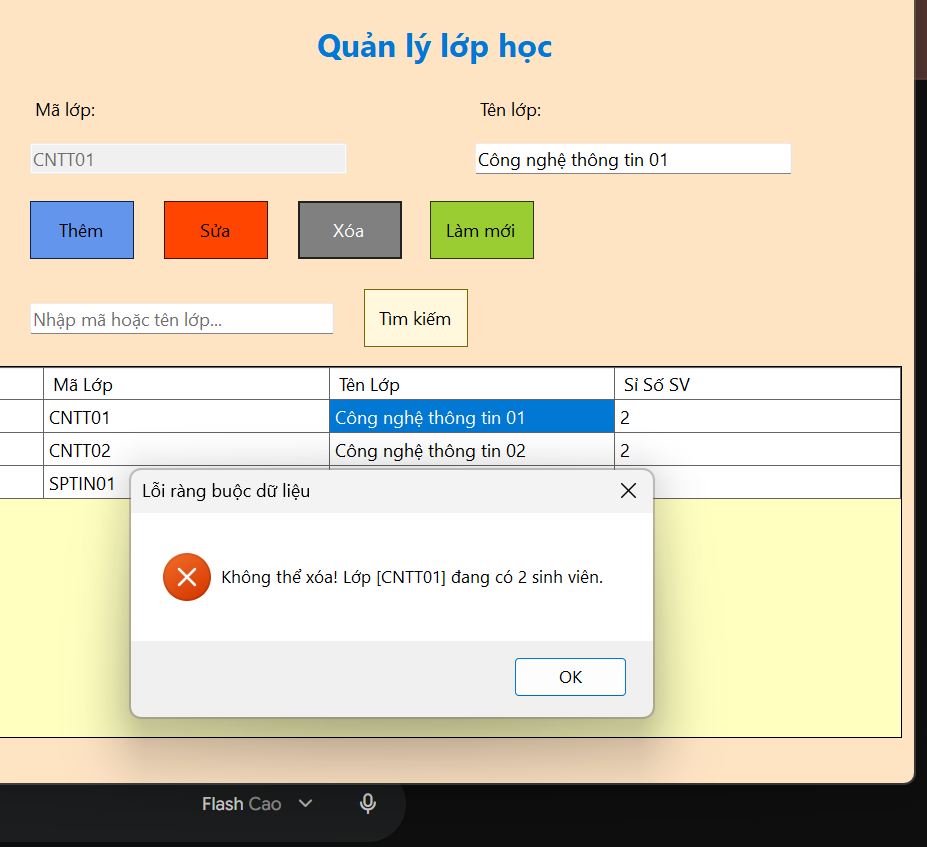

# TEST CASE LAB 15 VÀ CHECKLIST BÀN GIAO ĐỒ ÁN CUỐI KỲ

Tài liệu gồm **hai phần độc lập**:
- **Phần A:** Test case cho bài thực hành COMP1019 – Buổi 15 (Lab 15), sử dụng module **Quản lý lớp học (ClassManager)**.
- **Phần B:** Checklist bàn giao cho **đồ án cuối kỳ Quản lý nhân sự**.

---

# PHẦN A. TEST CASE – COMP1019 BUỔI 15 (LAB 15)

**Module thực hành:** Quản lý lớp học (ClassManager)  
**Mục tiêu:** Kiểm thử chức năng quản lý lớp và việc refactor module theo kiến trúc MVP.

## A1. Ảnh minh chứng kiểm thử Lab 15

**TC01 – Load danh sách lớp**

**TC02 – Thêm lớp hợp lệ**

**TC03 – Thêm lớp trùng mã**

**TC04 – Xóa lớp theo mã**

**TC05 và TC06 – Tìm kiếm theo mã/tên**

**TC07 – Kiểm tra dữ liệu rỗng**

**TC08 – Xóa lớp có sinh viên**

---

# PHẦN B. CHECKLIST BÀN GIAO ĐỒ ÁN CUỐI KỲ – QUẢN LÝ NHÂN SỰ

**Tên đề tài:** Hệ thống quản lý nhân sự  
**Tài khoản demo hiện tại:**
- Admin: `admin` / `admin123`
- HR: `hr` / `hr123`

> Phần này dùng để theo dõi tiến độ và chuẩn bị bàn giao đồ án cuối kỳ Quản lý nhân sự. Không phải test case của Lab 15.

## B1. Cấu trúc và kiến trúc chương trình

- [x] Đã tạo cấu trúc thư mục theo mô hình MVP.
- [x] Đã có các thành phần Models, Views, Presenters và Repositories.
- [x] Đã rà soát việc phân chia trách nhiệm giữa View, Presenter và Repository trên các module.
- [ ] Đã kiểm tra project biên dịch và chạy ổn định trên máy khác.

## B2. Các chức năng của đồ án

- [x] Hoàn thành module Department (Phòng ban).
- [x] Hoàn thành module Position (Chức vụ).
- [x] Đã code chức năng đăng nhập với hai tài khoản Admin và HR.
- [x] Có giao diện sáng (Light Mode) và tối (Dark Mode).
- [ ] Hoàn thành quản lý nhân viên (thêm, sửa, tìm kiếm).
- [ ] Hoàn thành quản lý hợp đồng.
- [ ] Hoàn thành quản lý quá trình công tác.
- [ ] Hoàn thành quản lý tài khoản (tạo, khóa, đặt lại mật khẩu).
- [ ] Hoàn thành phân quyền Admin/HR trên Form Main.

### Quy tắc phân quyền dự kiến

| Chức năng | HR | Admin |
|---|---|---|
| Quản lý nhân viên: thêm, sửa, tìm kiếm | Có | Có |
| Quản lý hợp đồng, quá trình công tác | Có | Có |
| Quản lý phòng ban, chức vụ | Chỉ xem hoặc không truy cập (cần chốt thiết kế) | Có |
| Xóa nhân viên | Không | Có |
| Quản lý tài khoản | Không | Có |
| Các chức năng quản trị khác | Theo quyền được cấp | Có |

**Tiến độ phân quyền:** Đăng nhập hai vai trò đã được code; phân quyền trên Form Main hiện chưa triển khai.

## B3. Cơ sở dữ liệu

- [x] Đã xây dựng database cho đồ án.
- [x] Đã có `App.config` để cấu hình kết nối.
- [x] Đã có `DbConnectionFactory.cs` để tạo kết nối database.
- [ ] Đã kiểm tra kết nối sau khi thay đổi cấu hình trên máy khác.
- [x] Đã chuẩn bị script tạo database và dữ liệu mẫu để bàn giao.
- [ ] Đã kiểm tra dữ liệu mẫu đủ để giảng viên chạy thử.

**Lưu ý cấu hình:** Khi chạy trên máy khác, kiểm tra và cập nhật thông tin kết nối trong `App.config` và `DbConnectionFactory.cs` theo cấu hình SQL Server của máy đó.

## B4. Kiểm thử đồ án cuối kỳ

- [x] Đã kiểm thử đăng nhập Admin.
- [x] Đã kiểm thử đăng nhập HR.
- [x] Đã kiểm thử đăng nhập sai thông tin.
- [x] Đã kiểm thử các chức năng Department.
- [x] Đã kiểm thử các chức năng Position.
- [x] Đã kiểm thử kết nối database.
- [x] Đã kiểm thử giao diện sáng/tối.
- [ ] Đã kiểm thử quyền của HR.
- [ ] Đã kiểm thử quyền của Admin.
- [ ] Đã kiểm thử các chức năng quản lý nhân viên.
- [ ] Đã kiểm thử quản lý hợp đồng và quá trình công tác.
- [ ] Đã kiểm thử quản lý tài khoản.
- [ ] Đã ghi nhận kết quả thực tế và ảnh minh chứng.

---

**Quy ước:** `[x]` là mục đã hoàn thành theo tiến độ được cung cấp; `[ ]` là mục chưa hoàn thành hoặc cần kiểm tra/xác nhận. Không đánh dấu hoàn thành nếu chưa kiểm thử thực tế.
---
Tiến độ hiện tại

- Tạo xong cấu trúc thư mục dạng MVP

- Xong full phần Department (Phòng ban)

- Xong full phần Position (Chức vụ)

- Xong Database (Tùy theo máy, chỉnh thì chỉnh trong App.config và DbConnectionFactory.cs)

- Code xong phần login, có 2 thứ là hr và admin, có giao diện sáng tối
  + Đăng nhập:
      + Tài khoản: admin, mật khẩu: admin123
      + Tài khoản: hr, mật khẩu: hr123
      
  + Mọi sự khác biệt về phân quyền giữa admin và hr sẽ code trong form main chứ hiện tại chưa có sự phân quyền 

- Chuẩn bị làm báo cáo và các file theo yêu cầu